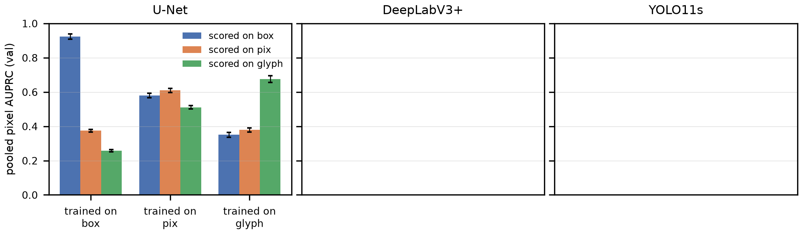

# AIC515 Görüntü İşleme — Dönem Projesi: AI-Generated Financial Document Forgery Localization (AIForge-Doc v1)

**Durum (11 Kasım 2026):** PHASE 1–4 tamamlandı. Ek tohumlar (43/44; işaretçisiz kutu U-Net ve birleşik kayıplı piksel U-Net) koşuldu, koşudan önce yazılan altı öngörünün altısı da tuttu (`reports/inceleme/deney_plani_ek_tohum_2026-11-10.md`). Faz 4 sürümü canlı Space'e dağıtıldı ve canlı test yinelendi (`reports/canli_test_v4deploy_log.txt`). IEEE bildirisi: `paper/main.pdf` (kaynak `paper/`, 10 sayfa; Faz 4 ve üç tohumlu sonuçlar dahil). Dönem içi raporu: `reports/Donem_Ici_Proje_Raporu.pdf` (v5). Faz 3 kapanış raporu: `reports/PHASE3_Sonuclar_ve_Kapanis.md`; Faz 4 raporu: `reports/PHASE4_ResNet_Sonuclar.md`; hakem hazırlığı: `reports/Hakem_Hazirligi_Faz3.md`; son tutarlılık denetimi: `reports/inceleme/paper_check_2026-11-10_v2.md`; kuyruk kesintisi incelemesi: `reports/inceleme/debug_kuyruk_kesintisi_2026-11-09.md`; otomatik tablolar: `phase3/results/tables_p3.md`, `phase3_v2/results/v2_tables.md`, `phase4_resnet/results/tables_p4.md`.
**Araştırma yönü:** *What Do Document Forgery Localizers Learn from Box Masks? Pixel-Change Ground Truth and Shortcut Audits for AI-Inpainted Financial Documents*. Ana sonuç: H1 doğrulandı (aynı tahminler bbox-GT AUPRC 0.923 → piksel-GT 0.374), H2 kısmen, H3/H4 yanlışlandı (bkz. `reports/PHASE2_Metodoloji_ve_Sonuclar.md`).


## Proje düzeni (10 Kasım 2026 — kod tek çatı altında)

Tüm kaynak kod **`kod/`** altındadır; veri ve çıktılar proje kökünde kalır ve `kod/` altındaki klasörler onları aynı göreli yolla
"aynalar" (ör. `kod/phase2/experiments/*.py` çıktılarını `phase2/experiments/{results,preds,logs,figures}` altına yazar).
Yol çözümlemesi tek dosyadadır: `kod/_paths.py` (`ROOT`, `KOD`, `out_dir(__file__)`; `VIZE_ROOT` ile değiştirilebilir).

```
Vize Proje/
├─ kod/                      TÜM KAYNAK KOD
│  ├─ _paths.py              proje kökü ve çıktı klasörü çözümlemesi
│  ├─ run_everything.ps1     Faz 1–2 uçtan uca hat
│  ├─ dataset_audit/         audit_dataset.py (14 boyutlu veri denetimi, splits.json)
│  ├─ baselines/             Faz 1 (küçük veri): klasik öznitelik + SVM/RF, ResNet-18, U-Net; common/{data,metrics}.py
│  ├─ phase2/                gt/ (GT türetimi) · controls/ · experiments/ (eğitim, tam görüntü çıkarım, değerlendirme, sondalar;
│  │                         common/{p2data,p2metrics}.py) · stats/ · literature_baselines/ (TruFor, ADCD-Net çalıştırıcıları)
│  ├─ phase3/                DeepLabV3+, işaretçi-onarımlı eğitim, birleşik kayıp, sondalar, sentez; q0–q4 kuyrukları (q4: ek tohumlar 43/44), env.ps1
│  ├─ phase3_yolo/           YOLO11: veri dönüştürme, eğitim, kutu→harita çıkarımı, tespit ölçütleri
│  ├─ phase3_v2/             AIForge-Doc v2 harici testi
│  ├─ phase4_resnet/         Faz 4: ResNet-18 tam veri + işaretçi onarımı + görüntü düzeyi eşik kalibrasyonu
│  ├─ app/                   Gradio uygulaması: app.py (giriş) + appcore/ (13 modül) + xai/ + xai_filters.py + meta/
│  ├─ hf_space/              Space dağıtım betikleri + space_src/ (Space README, requirements)
│  ├─ tools/                 build_report.py, build_space.py, make_arch_figures.py, capture_screens.py, build_manuscript.py ...
│  ├─ scripts/               xai_benchmark.py
│  └─ tests/                 test_app.py, test_app_p3.py, test_xai.py, test_xai_filters.py, ui_test.py, run_all_tests.ps1
├─ third_party/              TruFor, ADCD-Net (üçüncü parti kod + ağırlıklar; kendi lisansları)
├─ data/  models/            veri seti (yeniden dağıtılmaz) · eğitilmiş ağırlıklar
├─ dataset_audit/ baselines/ phase2/ phase3/ phase3_yolo/ phase3_v2/ phase4_resnet/ tests/    yalnız ÇIKTILAR (sonuç tabloları, şekiller, günlükler)
├─ app/                      arayüz ekran görüntüleri (ekran_*.png)
├─ docs/  reports/  paper/  literature/    belgeler, raporlar, IEEE bildirisi, literatür
├─ hf_space/                 TÜRETİLMİŞ Space paketi (elle düzenlenmez: `python kod/tools/build_space.py`)
├─ _arsiv/  _yedek/          eski kopyalar (silinmedi) · taşıma öncesi kod yedeği ve taşıma manifesti
└─ README.md  requirements.txt
```

| Klasör / dosya | İçerik |
|---|---|
| `reports/Donem_Ici_Proje_Raporu.{md,docx,pdf}` | **Dönem içi (vize) raporu** — `python kod/tools/build_report.py` ile Markdown'dan üretilir |
| `reports/Vize_Sunumu.pptx` | Dönem içi sunumu |
| `reports/PHASE1_Arastirma_Raporu`, `PHASE2_Metodoloji_ve_Sonuclar`, `PHASE3_Sonuclar_ve_Kapanis` | Faz raporları (literatür ve yön seçimi; GT türetimi, kontroller, H1–H4; Faz 3 kapanış) |
| `paper/` | IEEE bildirisi (LaTeX + `main.pdf`) |
| `literature/` | literatür matrisi (38 çalışma), `references_v3.bib` (81 kayıt; `paper/refs.bib` ile aynı), arama stratejisi, seed makale incelemeleri |
| `dataset_audit/` | `audit_report.md`, `audit_stats.json`, `splits.json` (grup-farkında train/val + küçük veri alt kümesi), örnek tabloları, şekiller |
| `data/AIForge-Doc-v1/` | Hugging Face'ten indirilen veri seti (**CC BY-NC-SA 4.0 + kapılı — yeniden dağıtmayın**) |
| `baselines/` | Faz 1 sonuçları: `results/`, `figures/`, `logs/`, `README.md` (tüm tablolar), `ENV_SETUP.md` |
| `phase2/gt/`, `phase2/controls/` | piksel-değişim/glif GT varyantları (3.247 eğitim + 89 test çifti), kontrol kümeleri, doğrulama çizelgeleri |
| `phase2/experiments/`, `phase2/stats/` | `results/` (özet ve görüntü başına tablolar, `tau.json`), `preds/`, `figures/`, istatistik kararları |
| `phase3/`, `phase3_yolo/`, `phase3_v2/` | Faz 3 tabloları (`results/tables_p3.md`, `numbers.json`), YOLO koşuları (`runs/`), v2 harici test sonuçları |
| `models/` | Faz 1 (`*.pt`), Faz 2–3 (`phase2/*.pt`: U-Net, DeepLabV3+, birleşik kayıplı U-Net), `phase3_yolo/` (katman filtreleri için YOLO gövdeleri), `phase4/` (ResNet-18 tam veri, 6 ağırlık) |
| `docs/` | `XAI.md`, `XAI_FILTERS.md`, XAI test ve ölçüm raporları |

## Hızlı başlangıç (kendi makinenizde)
1. Ortam: `baselines/ENV_SETUP.md` ve `requirements.txt` (conda + pip; RTX 5080 için PyTorch cu128 zorunlu).
2. Uygulama: `python kod/app/app.py` → http://127.0.0.1:7860 (ayrıntı: `kod/app/README_APP.md`).
3. Testler: `powershell -ExecutionPolicy Bypass -File kod/tests/run_all_tests.ps1` → `tests/run_all_summary.txt`.
4. Veri denetimi: `python kod/dataset_audit/audit_dataset.py --data data/AIForge-Doc-v1 --out dataset_audit --workers 24`
5. Faz 1 (küçük veri, ~25 dk GPU): `powershell kod/baselines/run_all.ps1` · Faz 1–2 uçtan uca: `kod/run_everything.ps1` · Faz 3: `kod/phase3/q*.ps1`.
6. Rapor: `python kod/tools/build_report.py` · Space paketi: `python kod/tools/build_space.py` (+ dağıtım: `kod/hf_space/deploy_hf.py`).

## Küçük-veri baseline özeti (smoke_train 400 / smoke_val 100, tek seed — çalışırlık kontrolü)
| Model | Ana metrik |
|---|---|
| SVM-RBF / RandomForest (56 klasik öznitelik) | AUROC 0.646 / 0.706 |
| ResNet-18 linear probe / full fine-tune / scratch | AUROC 0.726 / **0.899** / 0.679 |
| U-Net RGB | Pixel-F1@0.5 0.707, IoU 0.637, AUPRC 0.805 (kesin; ilk raporlanan alt-örneklemeli değer 0.947) |
| U-Net RGB+FFT-HP+Laplacian | Pixel-F1@0.5 0.674, AUPRC 0.792 (kesin; ilk raporlanan 0.939) |
| Dayanıklılık (U-Net RGB) | JPEG Q75 F1 0.636; 0.75× rescale F1 0.638 |

## Veri seti hakkında bilinmesi gerekenler (audit)
- Maskeler alan **bbox** maskesidir (piksel-değişim değil); eşleşen authentic ile fark alındığında bbox piksellerinin medyan %49'u (eps=8) değişir; çiftlerin %33.5'inde bbox dışı değişim vardır.
- `TestingSet/authentic` test sahtelerinin aynası değildir → image-level değerlendirmede kullanmayın; group-aware negatifler `splits.json` ile tanımlıdır.
- Test sahtelerinin %8.9'u train kaynak belgesini paylaşır → "temiz test" alt kümesi (740) ayrıca raporlanmalı.
- 12 metadata satırında bbox hatalı → GT olarak maske dosyasını kullanın.

## PHASE 2 ana sonuçları (tam veri, 3 seed)
| Bulgu | Değer |
|---|---|
| Resmî test, bbox-GT (U-Net bbox eğitimi) | AUPRC 0.950 ± 0.011, F1@τ* 0.846 ± 0.015 (temiz 740: aynı) |
| Aynı tahminler, piksel-GT | AUPRC 0.374; ΔF1 0.398 [0.377, 0.418] → **H1 doğrulandı** |
| Tahmin dikdörtgenselliği (bbox / piksel / glif modeli) | 0.87 / 0.32 / 0.05 |
| Sınır-blur relΔAP (bbox / piksel) | −1.5 % / −3.0 % → sınır shortcut'ı yanlışlandı; **H2 kısmen** |
| Held-out Ideogram, piksel − bbox ΔAP | +0.025 [−0.039, 0.088] → **H3 yanlışlandı** |
| Bbox-dışı crop forged/authentic AUROC | 0.516 (pozitif kontrol 0.980) → **H4 yanlışlandı** |
| Zero-shot TruFor / ADCD-Net (test, F1) | 0.403 / 0.182 |

## PHASE 3 — sonuçlar (10 Kasım 2026)


*Val pooled piksel AUPRC: eğitim maskesi (x) × değerlendirme GT'si (renk). U-Net 3 tohum, DeepLabV3+ 1 tohum, YOLO11s 3 tohum.*

| Bulgu | Değer | Tohum |
|---|---|---|
| H1: aynı tahminler, box-GT → piksel-GT (U-Net box modeli, val) | 0.923 → 0.374 | 3 |
| H1 tekrarı: DeepLabV3+ / YOLO11s | 0.929 → 0.382 / 0.965 → 0.368 | 3 / 3 |
| Kutu dedektörü (YOLO11s kare 1024), test box AUPRC / F1@τ* | 0.969 / 0.946 (U-Net 0.950 / 0.846) | 3 |
| İşaretçi onarımı ΔAP (U-Net box) → işaretçisiz yeniden eğitimde | −0.222 → +0.017 | 3 → 3 |
| İşaretçisiz yeniden eğitilen U-Net box: val / test box AUPRC (standart 0.923 / 0.950) | 0.912 ± 0.006 / 0.940 ± 0.003 | 3 |
| Test AP işaretçili / işaretçisiz (U-Net box) | 0.972 / 0.690 | 3 |
| Held-out: Gemini-only → Ideogram AP (U-Net box / işaretçisiz eğitimle / YOLO11s) | 0.412 / 0.463 / 0.725 | 3 / 3 / 3 |
| Birleşik kayıp (piksel + 0.5·box), val box-GT / piksel-GT AUPRC (test 89 çiftte piksel-GT farkı yok) | 0.579 → 0.668 / 0.610 → 0.633 | 3 |
| Gri seviye test girdisi, relΔ AUPRC | −50 … −67 % | 3 |
| AIForge-Doc v2 harici test (567 sızıntısız çift; yeniden eğitim ve kalibrasyon yok), box AUPRC: U-Net / işaretçisiz U-Net / YOLO11s | 0.520 / 0.711 / 0.887 | 3 / 3 / 3 |
| Zararsız kontroller, kutu dedektörü: görüntü AUROC (en yüksek kutu güveni) özgün / geri yapıştırma / yeniden örnekleme | 0.995 / 0.992 / 0.994 | 1 |
| Faz 1 AUPRC (kesin) | 0.947 → 0.805 | — |

### Yeniden üretim (Windows, tek 16 GB GPU, ≈14 GPU-saat)
```powershell
conda activate docforensics            # Python 3.11
pip install torch==2.11.0 torchvision==0.26.0 --index-url https://download.pytorch.org/whl/cu128
pip install -r phase3/requirements_phase3.txt --no-deps
$env:P3_PYTHON = (Get-Command python).Source
$env:VIZE_ROOT = (Get-Location).Path   # proje kökü
python kod/tools/download_dataset.py --out data/AIForge-Doc-v1      # HF kapılı erişim
powershell -File kod/run_everything.ps1 -SkipDownload            # Faz 1–2
powershell -File kod/phase3/q0_dataprep.ps1; powershell -File kod/phase3/q1_unet_train.ps1
powershell -File kod/phase3/q2_yolo_train.ps1 -Epochs 30
powershell -File kod/phase3/q3a_eval_unet.ps1; powershell -File kod/phase3/q3b_eval_yolo.ps1
python kod/phase3/synthesize_p3.py                                   # tablolar + şekiller
python kod/phase3/yolo_controls.py                                   # dedektörün zararsız kontrolleri (T7b_yolo_controls.csv)
powershell -File kod/phase3_v2/run_v2.ps1                            # AIForge-Doc v2 harici testi (v2 paketi data/AIForge-Doc-v2/ altında olmalı)
python kod/phase3_v2/v2_marker_paired_check.py                       # v2'de eşli kuralla işaretçi kalıntısı sayımı
python kod/phase2/gt/score_human_verification.py; python kod/phase2/gt/partial_note_check.py   # ikinci GT denetiminin özeti ve kısmi kararların not sınıflaması
```
Ağırlıklar ve tahmin haritaları repoda yoktur (boyut/lisans); yukarıdaki komutlarla üretilir. Faz 2 checkpoint'leri yeni ortamda birebir aynı çıktıyı verir (`phase3/results/repro_check_env.json`).

### Atıf
```bibtex
@misc{benli2026boxmasks,
  author = {Harun Benli},
  title  = {What Do Document Forgery Localizers Learn from Box Masks? Ground-Truth Geometry, a Hidden Marker Shortcut, and Box Detection on AI-Inpainted Financial Documents},
  year   = {2026},
  note   = {AIC515 Image Processing term project},
  howpublished = {\url{https://github.com/alfapars-exe/AIC515}}
}
```

### Faz 2'den devralınan işlerin kapanışı
| Açık iş (PHASE 2 / Lab Rat inceleme) | Faz 3'teki karşılığı | Kod |
|---|---|---|
| W2 tek mimari | DeepLabV3+ (aynı ResNet-18 kodlayıcı) × 3 GT; YOLO11 kutu dedektörü | `kod/phase3/train_unet_p3.py --arch dlv3p`, `phase3_yolo/` |
| W4/W5 işaretçi; GT işaretçiyi içeriyor | İşaretçi-onarımlı eğitim + işaretçisiz piksel/glif GT (`*_nm`) | `kod/phase3/make_marker_repaired.py`, `--marker-repair` |
| PHASE3-a birleşik kayıp | U-Net 2 kanal: piksel/glif + 0.5·bbox yardımcı | `--aux-bbox 0.5` |
| PHASE3-b 20 epoch | 3 GT × s42, 20 epoch | `train_unet_p2.py --epochs 20 --tag e20` |
| W3 held-out tek seed | Gemini-only × 3 GT × s43/s44 (toplam 3 seed) | `train_unet_p2.py --train-filter gemini_only` |
| PHASE3-d bölge görünümü | render-only / content-only sondası | `kod/phase3/probes_p3.py` |
| PHASE3-e kutu formülasyonu | YOLO11 n/s/m, kareli 1024 vs tam 1280, aug, authentic negatif | `phase3_yolo/` |
| §6.4 "test edilmedi" (CLAHE, gri) | Test-zamanı koşulları tüm modellerde | `kod/phase3/p3ext.py` |
| W6 Faz 1 AUPRC şişkin | Kesin AUPRC: 0.947 → **0.805** (rgb), 0.939 → **0.792** (rgbfreq) | `kod/phase3/phase1_exact_auprc.py` |
| Veri bias analizi | işaretçi × üretici Cramér's V 0.61; split χ² p ≥ 0.30 | `kod/phase3/dataset_curation.py` |
| Literatür | 77 doğrulanmış kaynak (38 yeni); bildirideki ek 2 yöntem kaynağı (Holm 1979, AdamW) ve 2 açıklanabilirlik kaynağıyla (SHAP, Samek vd.) 81 kayıt. 11 Kasım 2026'da atıf yapılan 64 kaynağın künyesi Crossref ve arXiv ile yeniden denetlendi; dokuz kayıt güncellendi | `literature/references_v3.bib`, `lit_update_phase3.md`, `reports/inceleme/atif_kunye_denetimi_2026-11-11.md` |
| W1 100 çift GT doğrulaması | **Kapandı (tek değerlendirici)** — insan denetimi yazar tarafından yapıldı: kutu 99/100 uygun; piksel GT 36 uygun / 64 kısmi (hepsi fazla kapsama) / 0 hatalı; VLM denetimiyle uyum zayıf (κ = 0.07). Açık kalan güçlendirme: ikinci bağımsız değerlendirici (form ve yönerge: `phase2/gt/verification_human.xlsx`) | `phase2/gt/human_verification_summary.md` |
| W7 TruFor ince ayar | **Yapılamadı** — yayımlanan kodda eğitim betiği yok; mimari bağımsızlık DeepLabV3+/YOLO ile | — |

Ortam: torch 2.11.0+cu128, smp 0.6.0, ultralytics 8.4.208; Faz 2 checkpoint'leri yeni ortamda birebir aynı çıktıyı verir (`phase3/results/repro_check_env.json`).

## PHASE 4 — ResNet-18 parça sınıflandırıcısı (10 Kasım 2026)
Rapor: `reports/PHASE4_ResNet_Sonuclar.md` · plan: `kod/phase4_resnet/README.md` · tablolar: `phase4_resnet/results/tables_p4.md`.

| Bulgu | Değer | Tohum |
|---|---|---|
| Val parça AUROC: Faz 1 (400 görüntü) → tam veri (2748 görüntü) | 0.926 → 0.983 ± 0.003 | 1 → 3 |
| Görüntü düzeyi val AUROC (487 sahte + 487 authentic): Faz 1 / tam veri / + işaretçi onarımı | 0.893 / 0.965 / 0.948 | 1 / 3 / 3 |
| Karar kuralı, tam veri modeli, val FPR: maks patch ≥ 0.5 → val'de kalibre eşik | 0.242 → 0.021 (TPR 0.951 → 0.886) | 3 |
| Resmî test (812 sahte + 89 eşli authentic), kalibre kural: AUROC / TPR / FPR | 0.978 / 0.901 / 0.022 | 3 |
| İşaretçi onarılınca sahte TPR (tam veri → işaretçisiz eğitim) | 0.471 → 0.899 | 3 |
| Authentic + yalnız işaretçi FPR (tam veri → işaretçisiz eğitim) | 0.955 → 0.458 | 3 |
| İşaretçisiz test sahtelerinde TPR (Faz 1 / tam veri / işaretçisiz eğitim) | 0.465 / 0.618 / 0.735 | 1 / 3 / 3 |

Yeniden üretim (≈ 20 dk GPU): `powershell -ExecutionPolicy Bypass -File kod\phase4_resnet\run_phase4.ps1 -Stage All`. Ağırlıklar `models/phase4/`; uygulamadaki ResNet eşikleri `kod/app/meta/resnet_image_tau.json`.

## Veri ve lisans
AIForge-Doc v1 (CC BY-NC-SA 4.0, kapılı erişim) bu repoda **yeniden dağıtılmaz**; görüntüler, türetilmiş maskeler, onarılmış görüntüler, kontrol setleri, model ağırlıkları ve tahmin haritaları repoya dahil değildir. Raporlarda, bildiride ve uygulama ekran görüntülerinde yer alan az sayıdaki örnek görüntü AIForge-Doc'tan alınmıştır; bu şekiller kaynak gösterilerek ve aynı lisans koşullarıyla (CC BY-NC-SA 4.0, ticari olmayan kullanım) paylaşılır. Doğrulama ızgarası sayfaları (`phase2/gt/verification_grid*`), adında `_LOCAL_ONLY` geçen şekiller ve denetim tablolarındaki metin alanları (`original_value`, `forged_value`) repoya gönderilmez (`kod/phase3/sync_repo.ps1`; veri etiği kontrol listesi: `reports/inceleme/veri_etigi_kontrol_listesi_2026-11-10.md`). Veri `kod/tools/download_dataset.py` ile indirilir, tüm türevler betiklerle yeniden üretilir (`kod/run_everything.ps1`, `kod/phase3/q*.ps1`). Üçüncü taraf referans modeller (TruFor, ADCD-Net) kendi depolarından kurulur (`phase2/literature_baselines/README.md`, `LICENSES.md`).

## Lisans
- **Kaynak kod** (`kod/` altındaki betikler ve uygulama): MIT lisansı, bkz. `LICENSE`.
- **Örnek görüntü içeren şekiller** (rapor, bildiri ve sunumdaki örnekler, `app/` altındaki ekran görüntüleri, `dataset_audit/`, `phase2/` ve `phase3/` altındaki örnekli şekiller) AIForge-Doc'tan türetilmiştir ve CC BY-NC-SA 4.0 koşullarıyla paylaşılır: kaynak gösterme, ticari olmayan kullanım, aynı lisansla paylaşım. Veri tabanı: Scam-AI/AIForge-Doc-v1 ve v2 (Hugging Face, kapılı erişim).
- **Rapor, bildiri ve sunum metinleri** MIT lisansının kapsamında değildir; hakları yazara aittir.
- **Üçüncü taraf bileşenler** kendi lisanslarına tabidir. Depoya dahil olmayanlar: Ultralytics YOLO11 (AGPL-3.0; bu depodaki YOLO betikleri onu kütüphane olarak çağırır), TruFor (yalnız kâr amacı gütmeyen kullanım), ADCD-Net (MIT). Depoda bulunan `paper/IEEEtran.cls` ve `paper/IEEEtran.bst` LaTeX Project Public License (LPPL 1.3) ile dağıtılır.
