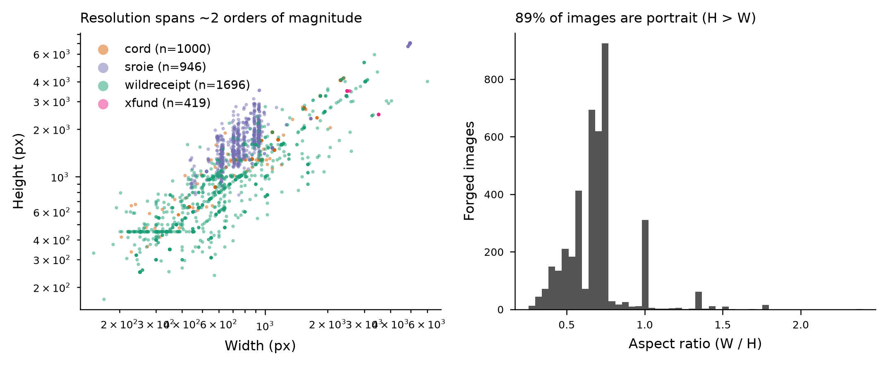
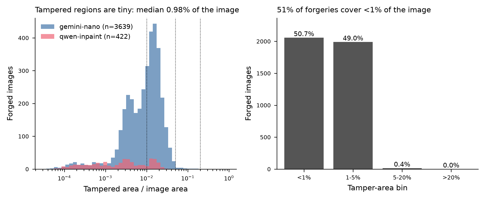
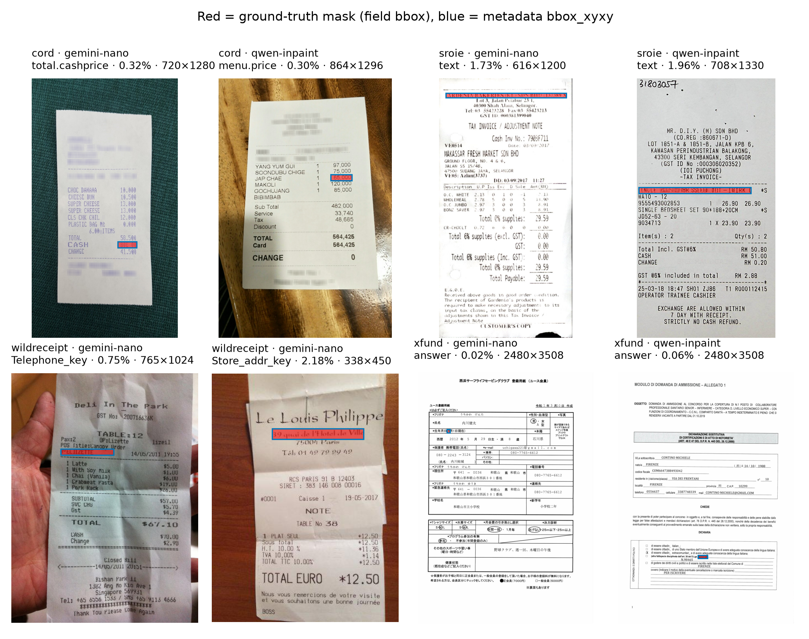
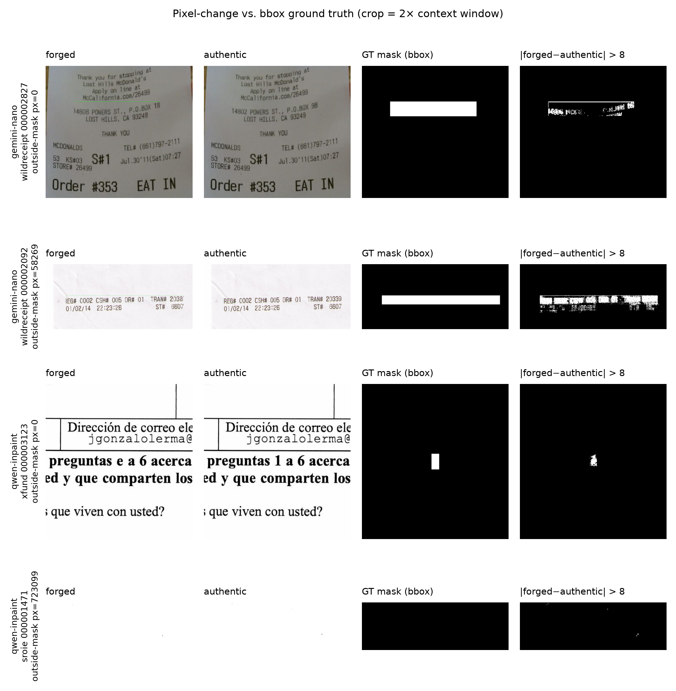

# AIForge-Doc v1 — Veri Seti Audit Raporu (14 boyut + annotation semantics + group-aware split)

**Veri seti:** Hugging Face `Scam-AI/AIForge-Doc-v1` (revision `b8db5654e9be`, lastModified 2026-08-06) · **Makale:** arXiv:2602.20569 (AIForge-Doc, v1 PDF 17 sayfa, tam metin okundu) · **Audit tarihi:** 2026-10-20
**Yerel kopya:** `Vize Proje/data/AIForge-Doc-v1/` — 12187 dosya, **9.98 GB** (Hub'ın raporladığı 9.98 GB ile tutarlı; indirme süresi 2085 s, huggingface_hub 2.2.0 / Xet).
**Yeniden üretim:** `python audit_dataset.py --data <data> --out <out> --workers 24` (çalışma süresi ~3 dk, 32 çekirdek). Tüm sayılar `audit_stats.json`'dan; hiçbir sayı karttan kopyalanmadı (kart iddiaları ayrı sütunda).

Etiketler: **[VERIFIED-LOCAL]** yerel dosyalardan kodla hesaplandı · **[VERIFIED-SOURCE]** kart/makale metninden birebir okundu · **[REPORTED]** kart/makale iddia ediyor, yerelde doğrulanamıyor · **[HYPOTHESIS]** · **[UNKNOWN]**

## 0. Yönetici özeti

| Konu | Kart/makale iddiası | Yerel bulgu |
|---|---|---|
| Sahte görüntü sayısı | 4.061 (3.249 / 812) | **3249 / 812** = 4061 ✓ [VERIFIED-LOCAL] |
| Authentic görüntü | README: 812 ("mirror of test split"); layout'ta sadece TestingSet | **TrainingSet/authentic 3249 + TestingSet/authentic 812** dosya var. Test-authentic'in yalnızca **86/812**'si bir test-forged'ın kaynağı; **254/812**'si TrainingSet/authentic ile bayt-özdeş, **535/812**'si pHash≤10 ile train-authentic kopyası → "mirror of test split" iddiası **yanlış** [VERIFIED-LOCAL] |
| Maske semantiği | "pixel-precise" (makale başlık/özet) ama §4.2: "exact field bounding box (tight)" | Maskeler **%100 dikdörtgen, tek bileşen, 0/255** [VERIFIED-LOCAL]. Piksel-değişim analizi: eps=8'de bbox piksellerinin **medyan %49**'i gerçekten değişiyor; IoU(D>8, maske) medyan **0.48** → bbox-maskesi, piksel-değişim maskesi değil |
| bbox dışı değişim | "only the tampered field is replaced" | eps=8'de çiftlerin **%33.5**'inde bbox dışında değişen piksel var (Gemini %35.9 vs Ideogram %11.9); 40 çiftte >%1 görüntü alanı [VERIFIED-LOCAL] |
| Train/test leakage | belirtilmemiş | Test-forged'ların **72/812 (%8.9)**'si pHash≤20 ile bir train görüntüsüne (forged veya authentic) yakın; 23'ü birebir pHash eşleşmesi [VERIFIED-LOCAL] |
| Generator metadata | var (`assigned_tool`) | var: gemini-nano 3639 / qwen-inpaint 422 ✓; ancak adlar kartta verilen ticari modellerle (Gemini 2.5 Flash Image / Ideogram v2 Edit) çelişiyor [VERIFIED-SOURCE] |
| Metadata bütünlüğü | — | 24 satırda `spec_id` çakışıyor; bunların 12'sinde `bbox_xyxy` maskeyle uyuşmuyor (satırlar arası karışmış provenance) [VERIFIED-LOCAL] |
| Lisans | README front-matter cc-by-nc-sa-4.0; dataset_info.json "CC BY 4.0"; README link by/4.0 | üç kaynak birbiriyle çelişiyor [VERIFIED-SOURCE] |

---

## 1. Dizin yapısı ve dosya formatı — [VERIFIED-LOCAL]

| Dizin | Dosya | GB |
|---|---|---|
| `.` | 4 | 0.002 |
| `TestingSet/authentic` | 812 | 1.150 |
| `TestingSet/images` | 812 | 0.987 |
| `TestingSet/masks` | 812 | 0.003 |
| `TrainingSet/authentic` | 3249 | 3.893 |
| `TrainingSet/images` | 3249 | 3.939 |
| `TrainingSet/masks` | 3249 | 0.010 |

- Uzantılar: {'': 1, '.json': 1, '.jsonl': 1, '.md': 1, '.png': 12183}; üst düzey: ['.gitattributes', 'README.md', 'dataset_info.json', 'metadata.jsonl']. README'de anılan `DATASHEET.md` **yok**.
- Sahte görüntüler: {'PNG': 4061} / mode {'RGB': 4061}; maskeler: {'PNG': 4061} / mode {'L': 4061} (8-bit gri). Authentic: {'PNG': 4061} / {'RGB': 4061}.
- Adlandırma: forged/mask dosyaları 9 haneli (`000000001.png`) — DocTamper uyumlu ✓. Authentic dosyaları **kaynak veri setinin orijinal adlarını** taşıyor (train: `cord_#`, `X5100…(SROIE)`, `xfund_#`, 40-hex sha1 / sayı (WildReceipt); test: `cord_#`, `wildreceipt_#`, `xfund_#`, **SROIE yok**). Bu adlar grouping için kullanılabilir kaynak-kimliği sağlar; ancak forged→authentic eşlemesi metadata'da **yok** (README'deki `image_id` alanı metadata.jsonl'da bulunmuyor).
- Format: düz PNG dizinleri; parquet/arrow yok (dolayısıyla `datasets` kütüphanesi gerekmedi, disk kullanımı = 9.98 GB).

## 2. Görüntü–maske eşleşmesi — [VERIFIED-LOCAL]

| Split | images | masks | authentic | maskesiz görüntü | görüntüsüz maske | metadata'sız görüntü | görüntüsüz metadata | tekrarlı new_id |
|---|---|---|---|---|---|---|---|---|
| training | 3249 | 3249 | 3249 | 0 | 0 | 0 | 0 | 0 |
| testing | 812 | 812 | 812 | 0 | 0 | 0 | 0 | 0 |

Eksik/çift eşleşme: **0**. Maske boyutu = görüntü boyutu: 4061/4061 ✓. `spec_id` benzersiz: 4049/4061 → **24 satır çakışan spec_id** (tamamı SROIE; bkz. §3 metadata bütünlüğü).

## 3. Maske değerleri ve annotation semantics — [VERIFIED-LOCAL] + [VERIFIED-SOURCE]

- Unique değer kümeleri: {'0;255': 4061} → **tüm maskeler ikili 0/255**; 0 = authentic, 255 = tampered (kart ve `dataset_info.json` ile tutarlı). Tamamen sıfır maske: 0.
- **Dikdörtgenlik** (maske alanı / maske bbox alanı): min 1.0000 · p05 1.0000 · p25 1.0000 · **median 1.0000** · p75 1.0000 · p95 1.0000 · max 1.0000 → **%100.0 tam dikdörtgen**. Bağlı bileşen sayısı dağılımı: {1: 4061} → her maske **tek bir dikdörtgen**.
- Metadata `bbox_xyxy` ↔ maske bbox: **4047/4061 birebir eşit** (x2,y2 **dahil** uç; "exclusive" yorumu 0 eşleşme). Kalan 14: 2'si görüntü sınırında kırpılmış bbox (IoU 0.978/0.947), **12'si IoU<0.9** ve bunların **12/12'si çakışan-spec_id satırları**: aynı `spec_id`'yi paylaşan iki SROIE satırının `bbox_xyxy`/`original_value`/`forged_value` alanları birbirine karışmış (ör. `tr_000000807` metadata bbox [250,351,659,384] ↔ maske [98,809,508,850]; bu bbox `tr_000001145`'in maskesine ait). **Sonuç:** maske dosyaları güvenilir, metadata'nın 12 satırı hatalı → metadata bbox'ı değil maskeyi ground-truth kabul et.
- **Semantik (kaynak):** Makale §4.2 "Tampered region = the exact field bounding box (tight, no padding)"; README "Patch-back — Only the exact field bbox region is pasted back…the ground-truth mask marks those pixels as 255"; `dataset_info.json`: `"mask_type": "binary (field bbox only)"`. Makalenin başlık/özetindeki "pixel-precise" ifadesi bu tanımla çelişir (bbox-precise).

### 3b. Annotation semantics: bbox vs pixel-change (forged − authentic farkı) — [VERIFIED-LOCAL]

Yöntem: her forged için aynı split'te aynı (W,H)'ye sahip authentic adaylar pHash-256 ile sıralandı (top-3), her aday **piksel farkıyla doğrulandı** (kural: same split, same (W,H); mean |forged-authentic| outside GT mask < 25.0 AND ((pHash<=60 AND <5% of image pixels changed by >8 outside mask) OR pHash<=10)). D = max_kanal |forged − authentic|; eps ∈ {0, 8}. Context penceresi = metadata bbox expanded per side by max(0.5*side, 100 px), clipped to image (interpretation of card text).

- Doğrulanmış çift: **3336/4061** (train **3247/3249**, test **89/812**). Kaynak-tutarlılığı (authentic dosya adından türetilen kaynak = metadata `source_dataset`): **%100**. Doğrulanmış çiftlerde pHash mesafesi: min 0 · p05 0 · p25 0 · **median 2** · p75 4 · p95 10 · max 56; doğrulanamayanlarda min 64 · p05 92 · p25 100 · **median 108** · p75 114 · p95 126 · max 150 (rastgele çift medyanı 126) → iki rejim net ayrışıyor.
- Boyut eşitliği: doğrulanmış tüm çiftlerde (W,H) eşit (kural gereği); aynı boyutta authentic bulunamayan forged: 308.
- Global sürüklenme: D'nin bbox dışı ortalaması min 0.00 · p05 0.00 · p25 0.00 · **median 0.00** · p75 0.23 · p95 0.52 · max 3.85; bbox dışı p99 min 0 · p05 0 · p25 0 · **median 0** · p75 2 · p95 4 · max 249.

| Metrik (n=3336 çift) | eps = 0 | eps = 8 |
|---|---|---|
| IoU(D>eps, GT maske) medyan [p25–p75] | 0.768 [0.096–0.947] | **0.481** [0.361–0.604] |
| bbox içinde gerçekten değişen piksel oranı medyan [p25–p75] | 0.950 [0.924–0.965] | **0.492** [0.374–0.620] |
| bbox DIŞINDA ≥1 değişen piksel olan çift | 1622 (%48.6) | **1117 (%33.5)** |
| bbox dışı >100 px / >%1 görüntü alanı | 1621 / 1588 | 423 / 40 |
| bbox dışı değişen piksel sayısı p75 / p95 / max | 42184 / 236071 / 6130104 | 6 / 845 / 723099 |
| bbox dışı değişimlerin context penceresi İÇİNDE kalan payı (medyan) | 0.21 | 0.06 |
| context penceresi ÖTESİNDE değişim olan çift | 1622 | 1045 |
| bbox içinde hiç değişim olmayan çift | 9 | 18 |

Yorum: (i) eps=0'da çiftlerin yaklaşık yarısında **tüm görüntüye yayılan ±1–3 düzeyinde** fark var (bbox dışı medyan D ≈ 0, p99 ≤ 4; context penceresi içinde kalan pay yalnızca 0.21) → yeniden kodlama/renk dönüşümü kaynaklı global iz; forensik model bunu "tüm görüntü sahte" ipucu olarak öğrenebilir ama authentic kopyaya göre tanımlı olduğundan test-zamanında kullanılamaz. (ii) eps=8'de bbox dışı anlamlı değişim çiftlerin üçte birinde var; 423 çiftte >100 px — tipik örnek: Gemini'nin bbox'ın bulunduğu **tüm satırı** yeniden sentezlemesi (bkz. `fig_pixel_diff_quads.png`, 2. satır). "no pixel outside bbox changed" iddiası **çürütülmüştür** (ama değişimlerin büyük kısmı küçük). (iii) bbox piksellerinin yalnızca ~%49'ı gerçekten değişiyor → bbox-maskeyle eğitilen bir U-Net, arka plan piksellerini "tampered" öğrenmeye zorlanır; piksel-IoU tavanı yapısal olarak sınırlıdır.

**Generator'a göre (eps=8):**

| Tool | n çift | IoU(D,maske) medyan | bbox-içi değişen oran medyan | bbox-dışı ≥1 px çift | bbox-dışı >100 px | >%1 görüntü | context ötesi değişim |
|---|---|---|---|---|---|---|---|
| gemini-nano | 3001 | 0.482 | 0.494 | 1077 (%35.9) | 407 | 37 | 1005 |
| qwen-inpaint (Ideogram) | 335 | 0.476 | 0.478 | 40 (%11.9) | 16 | 3 | 40 |

→ Gemini yolunda bbox-dışı sızıntı Ideogram'ın ~3 katı sıklıkta [VERIFIED-LOCAL]. Bu, generator-ayrımcı bir "shortcut" (bbox dışı iz = Gemini) oluşturabilir [HYPOTHESIS].

## 4. Kaynak veri seti dağılımı — [VERIFIED-LOCAL] (metadata) 

| | testing | training | All |
|---|---|---|---|
| cord | 200 | 800 | 1000 |
| sroie | 189 | 757 | 946 |
| wildreceipt | 339 | 1357 | 1696 |
| xfund | 84 | 335 | 419 |
| All | 812 | 3249 | 4061 |

Kart iddiası (WildReceipt 1.696 / CORD 1.000 / SROIE 946 / XFUND 419) ✓ birebir. Split oranı her kaynakta %20 (stratified) ✓ makale §4.1.

## 5. Generator dağılımı — [VERIFIED-LOCAL]

| | testing | training | All |
|---|---|---|---|
| gemini-nano | 727 | 2912 | 3639 |
| qwen-inpaint | 85 | 337 | 422 |
| All | 812 | 3249 | 4061 |

Kaynak × tool:
| | gemini-nano | qwen-inpaint |
|---|---|---|
| cord | 900 | 100 |
| sroie | 812 | 134 |
| wildreceipt | 1696 | 0 |
| xfund | 231 | 188 |

Kart (3.639 / 422) ve makale ("727 Gemini / 85 Ideogram test") ✓. WildReceipt'te **hiç Ideogram yok**; XFUND'da Ideogram %45 → tool ve kaynak **karıştırılmış (confounded)**: cross-generator deneyleri kaynak etkisinden ayrıştırılamaz [VERIFIED-LOCAL]. Sub-task'ta anılan "v2 makalesi 2.729 / 333" sayıları elimizdeki v1 PDF ve kartta yok → [UNKNOWN].

## 6. Generator adlandırma tutarlılığı — [VERIFIED-SOURCE]

- metadata `assigned_tool` ∈ ['gemini-nano', 'qwen-inpaint'].
- Kart/`dataset_info.json`: `gemini-nano` = "Gemini 2.5 Flash Image (Google, via OpenRouter)"; `qwen-inpaint` = "Ideogram v2 Edit (fal.ai/ideogram/v2/edit)". Makalede "Qwen" kelimesi **hiç geçmiyor**; "gemini-nano" kod adı Google'ın cihaz-içi Gemini Nano modeliyle karışabilir. → Kod adları içsel etiketlerdir; raporlarda "gemini-nano (Gemini 2.5 Flash Image)" / "qwen-inpaint (Ideogram v2 Edit)" diye yazılmalı; gerçek API'nin hangisi olduğu yalnızca kart beyanına dayanır [REPORTED].

## 7. Belge tipi ve dil dağılımı — [VERIFIED-LOCAL]

| | testing | training | All |
|---|---|---|---|
| form | 84 | 335 | 419 |
| receipt | 728 | 2914 | 3642 |
| All | 812 | 3249 | 4061 |

Dil: de 78, en 2642, es 67, fr 56, id 1000, it 81, ja 37, pt 62, zh 38. Kartla birebir ✓ (receipt %89.7). Not: kartın "invoice" belge tipi yok; "financial document" iddiası pratikte **fiş + form**.

## 8. Değiştirilen alan (field_name) dağılımı — [VERIFIED-LOCAL]

38 farklı alan adı. İlk 12: `Telephone_key` 931, `text` 880, `Store_addr_key` 457, `answer` 419, `menu.price` 404, `Prod_item_key` 152, `total.cashprice` 134, `menu.unitprice` 127, `sub_total.subtotal_price` 100, `menu.nm` 77, `Tel_key` 57, `company` 43.
Kaynak başına en sık 5: {'cord': {'menu.price': 404, 'total.cashprice': 134, 'menu.unitprice': 127, 'sub_total.subtotal_price': 100, 'menu.nm': 77}, 'sroie': {'text': 880, 'company': 43, 'address': 23}, 'wildreceipt': {'Telephone_key': 931, 'Store_addr_key': 457, 'Prod_item_key': 152, 'Tel_key': 57, 'Date_key': 35}, 'xfund': {'answer': 419}}.
Orijinal/sahte değer uzunluğu eşit: %100.0; orijinal = sahte (değişmemiş) değer: %0.00.
Tutarsızlık: README "Telephone / store address 1.388" ↔ `dataset_info.json` `Telephone_key` 931 + `Store_addr_key` 457 = 1.388 (README iki alanı birleştirmiş, ayrıca "Store address 457" satırını tekrar sayıyor). Makale "numeric fields (price > date > ID > qty)" önceliği der; ancak SROIE'de alan **`text` (880)** ve **`address`** gibi serbest metin alanları baskın.

## 9. Çözünürlük istatistikleri — [VERIFIED-LOCAL]

- W: min 150 · p05 300 · p25 500 · **median 750** · p75 1080 · p95 2480 · max 6016 px; H: min 168 · p05 348 · p25 648 · **median 1296** · p75 1929 · p95 4096 · max 7016 px; megapiksel: min 0.03 · p05 0.12 · p25 0.33 · **median 1.01** · p75 1.92 · p95 9.44 · max 34.81; en-boy (W/H): min 0.25 · p05 0.41 · p25 0.56 · **median 0.71** · p75 0.75 · p95 1.00 · max 2.39; portre oranı %89; benzersiz (W,H) sayısı 1372.
- Kaynak başına medyan W×H (MP): cord 864×1296 (1.12), sroie 795×1695 (1.42), wildreceipt 450×500 (0.21), xfund 2480×3508 (8.70).
- Makale "XFUND … up to 4961×7016 px" der; yerelde 4961×7016 görüntüler **SROIE** (X-prefix) kaynaklı, XFUND 2480×3508 (A4@300dpi) [VERIFIED-LOCAL].
- Model girdisi için sonuç: 512×512 yeniden boyutlandırma ile <1% alanlı bir alan (medyan bbox 191×33 px) birkaç piksele düşer → tam çözünürlük tile/crop stratejisi zorunlu.

## 10. Tamper-area / image-area oranı — [VERIFIED-LOCAL]

- Oran: min 0.003 · p05 0.041 · p25 0.369 · **median 0.975** · p75 1.616 · p95 2.770 · max 15.209 % (makale "median 0.9%" ✓). Tampered piksel: min 152 · p05 1150 · p25 2610 · **median 5820** · p75 15880 · p95 64970 · max 578613.
- Dilimler: | dilim | n | |---|---| | <1% | 2057 | | 1-5% | 1989 | | 5-20% | 15 | | >20% | 0 | → **<1%: %50.7, 1–5%: %49.0, 5–20%: %0.4, >20%: 0**. Split bazında: {'training': {'<1%': 1628, '1-5%': 1608, '5-20%': 13, '>20%': 0}, 'testing': {'<1%': 429, '1-5%': 381, '5-20%': 2, '>20%': 0}}. Kaynak bazında: {'cord': {'<1%': 958, '1-5%': 42, '5-20%': 0, '>20%': 0}, 'sroie': {'<1%': 243, '1-5%': 703, '5-20%': 0, '>20%': 0}, 'wildreceipt': {'<1%': 437, '1-5%': 1244, '5-20%': 15, '>20%': 0}, 'xfund': {'<1%': 419, '1-5%': 0, '5-20%': 0, '>20%': 0}} (XFUND'un tamamı <1%; CORD %96 <1%).
- Tool bazında medyan oran: gemini-nano %1.07, qwen-inpaint %0.27.
- Bağlı bileşen: her maskede **1** ({1: 4061}); en küçük bileşen alanı = maske alanı: min 152 · p05 1150 · p25 2610 · **median 5820** · p75 15880 · p95 64970 · max 578613 px. Maske bbox yüksekliği: min 7 · p05 13 · p25 22 · **median 33** · p75 45 · p95 88 · max 467 px; genişliği min 9 · p05 53 · p25 114 · **median 191** · p75 452 · p95 813 · max 2726 px.

## 11. Duplicate ve kaynak-belge türevleri — [VERIFIED-LOCAL]

- **Bayt-özdeş (MD5)**: 307 grup / 618 dosya. Forged–forged özdeş: 12 grup; authentic–authentic özdeş: 285 grup (train-authentic içinde 34 tekrar; ör. `X51006328937.png` ≡ `X51006329399(1).png` — SROIE'nin kendi kopyaları; train↔test authentic arası 254 özdeş dosya).
- **pHash-256 near-duplicate** (Hamming ≤ 20; rastgele çift mesafesi medyan 126, p05 112): toplam 5374 çift; forged–forged **274** çift (441 forged görüntü etkileniyor; aynı split içinde 189). Eşik duyarlılığı (forged–forged çift): ≤0: 56, ≤5: 157, ≤10: 231, ≤15: 250, ≤20: 274, ≤25: 314, ≤30: 407, ≤40: 769.
- **Aynı kaynak görüntünün birden fazla manipüle kopyası var mı?** Evet: doğrulanmış eşlemede 41 authentic dosya 2–3 forged'ın kaynağı (dağılım {'1': 3251, '2': 38, '3': 3}); kaynak-belge gruplarında 451 forged çok-üyeli grupta (grup başına forged dağılımı {'1': 3610, '2': 189, '3': 15, '4': 2, '8': 1, '12': 1}). Makalenin "each source image contributes exactly one forged image … one-to-one" iddiası dosya-kimliği düzeyinde doğru olabilir ama **içerik düzeyinde değil** (kaynak veri setlerinin kendi tekrarları + aynı mağazanın çok sayıda fişi).
- Kullanılmayan authentic: 769 (büyük kısmı TestingSet/authentic — bkz. §13).

## 12. Train/test leakage riski — [VERIFIED-LOCAL]

Kaynak-belge grubu = (doğrulanmış forged↔authentic kenarları) ∪ (pHash ≤ 20 kenarları) üzerinde bağlı bileşenler; toplam 4022 grup.

| Metrik | Değer |
|---|---|
| Train ve test'e yayılan grup sayısı | **581** |
| Bu gruplardaki test-forged / train-forged | **72 (%8.9 of test)** / 636 |
| Test-forged'ın pHash ≤0 / ≤5 / ≤10 / ≤20 / ≤30 ile bir TRAIN görüntüsüne (forged∪authentic) yakın olması | 23 / 53 / 63 / 72 / 85 |
| … yalnız train-FORGED'a | 19 / 46 / 62 / 70 / 82 |
| … yalnız train-AUTHENTIC'e | 13 / 46 / 58 / 68 / 84 |
| Cross-split near-dup çiftleri (forged–forged / forged–authentic / authentic–authentic) | 85 / 670 / 595 |
| Cross-split bayt-özdeş gruplar | 262 |
| Etkilenen test-forged'ın kaynağı | {'sroie': 27, 'cord': 26, 'wildreceipt': 18, 'xfund': 1} |

**Değerlendirme.** (a) *Lokalizasyon (forged→mask)*: test-forged'ların ~%9'i train'de görülmüş bir belgenin (farklı alanı manipüle edilmiş) kopyası — orta düzey leakage; makalede split'in "source dataset ve tool'a göre stratified" yapıldığı ama **kaynak-belgeye göre gruplanmadığı** anlaşılıyor. (b) *Görüntü-düzeyi sınıflandırma (forged vs authentic)*: **ciddi** — TestingSet/authentic'in 535/812'si (%66) TrainingSet/authentic'in kopyası (254'ü bayt-özdeş) ve 530/812'si bir **train-forged**'ın kaynak belgesi. Train-authentic'i negatif örnek olarak kullanan bir sınıflandırıcı test negatiflerinin üçte ikisini ezberlemiş olur; kartın TruFor/DocTamper/GPT-4o sonuçları zero-shot olduğu için bundan etkilenmez, ama **bu veri setiyle eğitilecek her model için resmi test setinin authentic yarısı geçersizdir.**

## 13. Authentic (unmanipulated) örnekler — [VERIFIED-LOCAL]

- Var: TrainingSet/authentic **3249**, TestingSet/authentic **812** (README layout'ta train-authentic yok; "At a Glance" 812 der).
- Train-authentic: 3247/3249 train-forged için piksel-doğrulanmış kaynak (kaynak uyumu %100); yani **train tarafında neredeyse tam forged/authentic çift yapısı var** → piksel-değişim maskesi türetilebilir, çift-tabanlı (siamese/difference) eğitim mümkün.
- Test-authentic **mirror değil**: yalnızca 86/812 dosya bir test-forged'ın doğrulanmış kaynağı (89 test-forged); 203/812 hiçbir forged'a pHash≤20 yakın değil; **SROIE kaynaklı test-authentic hiç yok** ({'wildreceipt': 382, 'xfund': 262, 'cord': 168} ↔ test-forged {'wildreceipt': 339, 'cord': 200, 'sroie': 189, 'xfund': 84}). Bu nedenle 812 test-forged'ın 723'sinin authentic eşi veri setinde yok.
- **Image-level detection için gereken:** (i) negatifleri TrainingSet/authentic'ten, pozitiflerle aynı kaynak-belge grubunu paylaşmayacak şekilde group-aware ayırmak (splits.json'daki gruplar bunu sağlar — authentic eşler forged ile aynı gruptadır); (ii) resmi test için authentic negatif olarak yalnızca train ile ilişkisiz 277 test-authentic'i kullanmak **veya** test-authentic'i tamamen dışlayıp pozitif/negatif raporlamasını lokalizasyon metriklerine (pixel-AUC/IoU) kaydırmak; (iii) authentic negatiflerin forged ile aynı kaynak dağılımına sahip olmadığını (SROIE eksik) raporlamak.

## 14. Lisans ve yeniden dağıtım — [VERIFIED-SOURCE] + [UNKNOWN]

| Kaynak | Beyan |
|---|---|
| README front-matter `license:` | `cc-by-nc-sa-4.0` |
| README "Licence" bölümü | "released under cc-by-nc-sa-4.0" ama link `creativecommons.org/licenses/by/4.0/` ve metin "free to share and adapt for any purpose" (NC/SA ile çelişir) |
| `dataset_info.json` | `"license": "CC BY 4.0"` |
| Gating | gated=true; "non-commercial research purposes only" + atıf onay kutusu |
| Kaynak lisansları (kart) | CORD v2 CC BY 4.0 · WildReceipt Apache 2.0 · SROIE "ICDAR 2019 research use" · XFUND CC BY 4.0 |

Değerlendirme: en kısıtlayıcı okuma geçerli kabul edilmeli → **CC BY-NC-SA 4.0 + gating şartları**: ticari kullanım yok, türev (ör. yeni maskeler, alt kümeler) aynı lisansla paylaşılmalı, atıf zorunlu. SROIE'nin "research use" koşulu ayrıca ticari kullanımı engeller; CORD/XFUND/WildReceipt atıf gerektirir. Kaynak lisanslarının orijinal metinleri bu audit'te açılmadı → [UNKNOWN] (kart beyanı). Ders projesi (akademik, ticari olmayan) kapsamında kullanım uygundur; **görüntülerin yeniden dağıtımı yapılmamalı**, yalnızca id listeleri (splits.json) paylaşılmalı.

## 15. Tespit edilen tutarsızlıklar (paper ↔ dataset kartı ↔ metadata ↔ dosyalar)

1. **Authentic sayısı/rolü:** README 812 "mirror of test split" ve layout'ta sadece TestingSet/authentic ↔ repoda 3.249 + 812; test-authentic'in %89'i test-forged'ın kaynağı değil, %66'i train-authentic kopyası [VERIFIED-LOCAL].
2. **Metadata şeması:** README `image_id`, `final_image_path`, `final_mask_path` alanlarını listeler; metadata.jsonl'da yok; `image`/`mask` alanları var ama README'de yok [VERIFIED-LOCAL].
3. **spec_id çakışması / satır karışması:** 24 satır, 12 hatalı bbox [VERIFIED-LOCAL].
4. **Maske semantiği:** makale başlık/özet "pixel-precise" ↔ §4.2 ve kart "field bbox" ↔ ölçüm: bbox piksellerinin ~%49'ı değişiyor [VERIFIED-LOCAL].
5. **Context padding:** README "minimum 100 px" ↔ makale §3.3 "minimum 150 px padding" [VERIFIED-SOURCE].
6. **Generator adları:** metadata `gemini-nano`/`qwen-inpaint` ↔ kart "Gemini 2.5 Flash Image"/"Ideogram v2 Edit"; makalede "Qwen" yok [VERIFIED-SOURCE].
7. **Lisans:** cc-by-nc-sa-4.0 (front-matter) ↔ CC BY 4.0 (dataset_info.json, README linki) [VERIFIED-SOURCE].
8. **DATASHEET.md** README'de var, repoda yok [VERIFIED-LOCAL].
9. **README field tablosu** "Telephone / store address 1.388" + ayrıca "Store address 457" (çifte sayım) ↔ dataset_info.json ayrı sayar [VERIFIED-SOURCE].
10. **Çözünürlük atfı:** makale XFUND için 4961×7016 der; yerelde bu boyut SROIE'ye ait, XFUND 2480×3508 [VERIFIED-LOCAL].
11. **"one-to-one authentic/forged"** (makale §4.1) ↔ 41 authentic'in 2–3 forged kaynağı olması ve 274 forged–forged near-dup çifti [VERIFIED-LOCAL].
12. **Citation bloğu** placeholder (`YOUR_ORG`, `your-email@institution.edu`) — kart tamamlanmamış [VERIFIED-SOURCE].
13. Makale "numeric field" odağı ↔ SROIE'de 880 `text` + adres alanları (serbest metin) [VERIFIED-LOCAL].

## 16. Group-aware validation split önerisi — [VERIFIED-LOCAL]

- Resmî test (812) **dokunulmadı**. Train (3249) kaynak-belge gruplarına göre bölündü: **train 2762 / val 487** (val oranı %15.0; 3088 grup, val'de 469 grup; val–train grup kesişimi yok: True). Test'e dokunan 581 train grubu val'e alınmadı (train'de bırakıldı ve bayraklandı).
- Gruplama: source-document groups = connected components over (forged<->paired authentic edges, pHash-256 hamming<=20) ∪ (pHash-256 near-duplicate edges, hamming<=20) over all forged+authentic images of both splits; val sampled by whole groups (seed=42, target 15% of train); groups touching the test split are kept in train and flagged
- Bileşim (kaynak / tool / alan dilimi):

| Alt küme | n | wildreceipt / cord / sroie / xfund | gemini / ideogram | <1% / 1–5% / 5–20% | grup |
|---|---|---|---|---|---|
| train | 2762 | 1159 / 679 / 638 / 286 | 2466 / 296 | 1397 / 1354 / 11 | 2619 |
| val | 487 | 198 / 121 / 119 / 49 | 446 / 41 | 231 / 254 / 2 | 469 |
| test | 812 | 339 / 200 / 189 / 84 | 727 / 85 | 429 / 381 / 2 | 795 |
| smoke_train | 400 | 87 / 85 / 170 / 58 | 254 / 146 | 202 / 196 / 2 | 390 |
| smoke_val | 100 | 28 / 20 / 38 / 14 | 75 / 25 | 47 / 52 / 1 | 100 |

- **Smoke subset** (`smoke_train` 400, `smoke_val` 100): stratified by tamper-area bin (<1%,1-5%,5-20%,>20%) proportional to the parent subset; within bin round-robin over (source_dataset, assigned_tool) cells. Sonuç olarak alan dilimleri ebeveynle orantılı, kaynak×tool hücreleri eşitlenmiş (bu yüzden ideogram payı %36, tam sette %10). Baseline aşaması bu id'leri `TrainingSet/images|masks/<id>.png` olarak okur; authentic eşi `samples_forged.csv` → `pair_name` sütunundan (`TrainingSet/authentic/<pair_name>`).
- Dosya: `splits.json` → anahtarlar `train`, `val`, `test`, `smoke_train`, `smoke_val`, `grouping_method`, `notes`, `id_convention`.

## 17. Veri seti bu projeyi nasıl kısıtlıyor?

1. **Lokalizasyon hedefi bbox'tır, piksel değil.** U-Net/segmentasyon için pixel-IoU, bbox içindeki değişmeyen arka plan yüzünden tavanlıdır (gerçek değişim bbox'ın ~%49'ı). Değerlendirmede bbox-IoU / alan-düzeyi F1 ve piksel-AUC birlikte raporlanmalı; alternatif olarak train'de doğrulanmış çiftlerden **piksel-değişim maskesi** (D>8) türetilip ikinci bir GT olarak kullanılabilir (test'te çift olmadığı için yalnızca train/val).
2. **Küçük bölge:** medyan %0.98 alan, maske yüksekliği medyan 33 px; görüntüler 0.03–35 MP. Tam görüntüyü 512'ye küçültmek bölgeyi yok eder → tile/crop tabanlı eğitim ve çıkarım şart; sınıf dengesizliği (≈1:100) için Dice/focal kaybı.
3. **Görüntü-düzeyi sınıflandırma için resmi test authentic'i güvenilmez** (§12–13); proje kendi group-aware negatiflerini (train-authentic'ten) kullanmalı ve bunu açıkça raporlamalı. Resmi test üzerinde yalnızca lokalizasyon metrikleri ve forged-only analizler güvenle raporlanabilir; image-level AUC için 'train-ile-ilişkisiz 277 authentic' alt kümesi tanımlanmalı.
4. **Generator ↔ kaynak confound:** WildReceipt'te Ideogram yok, XFUND'da %45. Cross-generator genelleme deneyi kaynak etkisiyle karışır; kontrol için CORD/SROIE/XFUND içinde tool-eşlenmiş alt kümeler kullanılmalı.
5. **Leakage:** test-forged'ların %8.9'i train kaynak belgesini paylaşır; sonuçlar "temiz test" (740 görüntü) ve "tam test" olarak ayrı raporlanabilir (id listesi `samples_forged.csv` → `nn_train_any_dist` sütunu).
6. **Metadata'ya körü körüne güvenme:** 12 satırda bbox/değer karışık; alan adı, dil, kaynak güvenilir; bbox için maske kullan.
7. **Lisans:** CC BY-NC-SA 4.0 + gated; görüntü/maske yeniden dağıtımı yok, ticari kullanım yok.
8. **Tek belge aile/dil dağılımı:** %90 fiş, EN+ID %90; "finansal belge" genellemesi (fatura, banka ekstresi) desteklenmez.

## Ek — çıktı dosyaları

`audit_dataset.py`, `audit_stats.json`, `samples_forged.csv` (satır başına: maske istatistikleri, pHash/dHash/MD5, authentic eşi, piksel-değişim metrikleri, grup id, train'e en yakın mesafe), `samples_authentic.csv`, `phash_pairs.csv`, `splits.json`, `dataset_card_snapshot.md`, `fig_resolution.png`, `fig_tamper_ratio.png`, `fig_examples_overlay.png`, `fig_pixel_diff_quads.png`.
