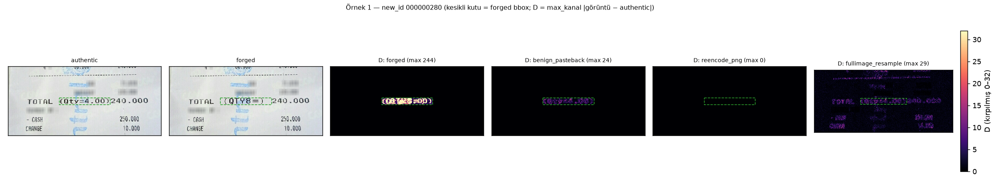
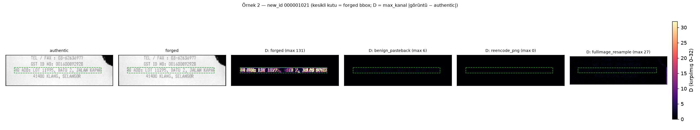
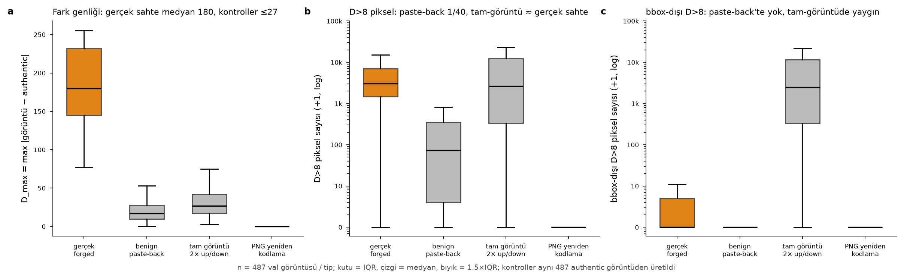

# Benign kontrol setleri — rapor

Üretim: `make_controls.py`. Kontrol başına görüntü sayısı: {'benign_pasteback': 487, 'fullimage_resample': 487, 'reencode_png': 487}. Split üyeliği: {'val': 387, 'val;smoke_val': 100}.

Boş maskeler `controls/<type>/masks/` altında (tamamen 0). Tüm kontroller içerik değiştirmez; yalnız yeniden-örnekleme/yeniden-kodlama izi taşır.

**reencode_png piksel özdeşlik:** 487/487 görüntü authentic ile birebir özdeş → bu kontrol piksel düzeyinde ANLAMSIZ (yalnız dosya/kodlama düzeyi kontrol; modele girdi olarak authentic ile aynıdır).

## Asimetri ölçümü: D = max_kanal |kontrol − authentic| vs gerçek forged çiftleri (aynı id'ler)

| tip | n | D_max medyan [IQR] | D_mean medyan | D>8 px medyan [IQR] | D>8 bbox-içi medyan | D>8 bbox-dışı medyan | D>0 px medyan | D>0 bbox-dışı medyan | görüntü oranı: ≥1 px D>8 | görüntü oranı: ≥1 px D>8 bbox-dışı |
|---|---|---|---|---|---|---|---|---|---|---|
| REAL_FORGED | 487 | 180 [145–232] | 0.326 | 3020 [1464–6936] | 2858 | 0 | 20425 | 0 | 0.996 | 0.308 |
| benign_pasteback | 487 | 17 [10–28] | 0.015 | 72 [3–348] | 72 | 0 | 4026 | 0 | 0.807 | 0.000 |
| reencode_png | 487 | 0 [0–0] | 0.000 | 0 [0–0] | 0 | 0 | 0 | 0 | 0.000 | 0.000 |
| fullimage_resample | 487 | 27 [17–42] | 0.734 | 2627 [331–12166] | 72 | 2466 | 310638 | 301739 | 0.938 | 0.938 |

bbox içinde D>8 kapsama medyanı (n_gt8_in / bbox_px): REAL_FORGED 0.488; benign_pasteback 0.018; reencode_png 0.000; fullimage_resample 0.018

bbox içi / dışı ortalama D medyanı: REAL_FORGED 25.73 / 0.00; benign_pasteback 2.04 / 0.00; reencode_png 0.00 / 0.00; fullimage_resample 2.03 / 0.72

**Asimetri bulgusu (hesaplanan):** gerçek forged çiftlerinde D_max medyanı 180 ve D>8 piksel medyanı 3020 (bbox kapsama 0.488). benign_pasteback: D_max medyanı 17, D>8 piksel medyanı 72 (gerçek sahtenin ~1/42'i; görüntülerin %80.7'inde ≥1 px D>8; tamamı bbox içinde, bbox-dışı D>8 medyanı 0). fullimage_resample: D_max medyanı 27, ancak D>8 piksel medyanı 2627 — gerçek sahtenin D>8 piksel sayısına YAKIN (medyan oranı 0.87) ve görüntülerin %93.8'inde mevcut; bu pikseller tüm görüntüdeki metin kenarlarına dağılır (bbox-dışı D>8 medyanı 2466, bbox içi kapsama 0.018). Sonuç: (i) genlik (D_max) açısından kontroller gerçek sahteden net ayrılır (17–27 vs 180); (ii) D>ε tabanlı bir piksel-değişim GT'si benign_pasteback'te az sayıda, fullimage_resample'da ise gerçek sahteyle karşılaştırılabilir SAYIDA yanlış pozitif piksel üretir — fark sayıda değil, genlikte ve uzamsal dağılımdadır (yoğun blok yerine seyrek kenar pikselleri). Bu nedenle fullimage_resample, 'yeniden-örnekleme izi = sahtelik' kısayolunu test eden en zorlu kontroldür; bbox-GT ile eğitilen bir modelin benign_pasteback'in bbox sınırında veya fullimage_resample'ın metin kenarlarında pozitif üretmesi kısayol kanıtı olarak değerlendirilecektir.

benign_pasteback'te piksel-özdeş kalan görüntü sayısı: 2/487 (bbox bölgesi düz/tek renk olduğundan yeniden-örnekleme iz bırakmamış).

## Atlananlar
- pair_accepted==False (authentic eşi doğrulanamamış): yok
- samples_forged.csv'de bulunamayan id: yok
