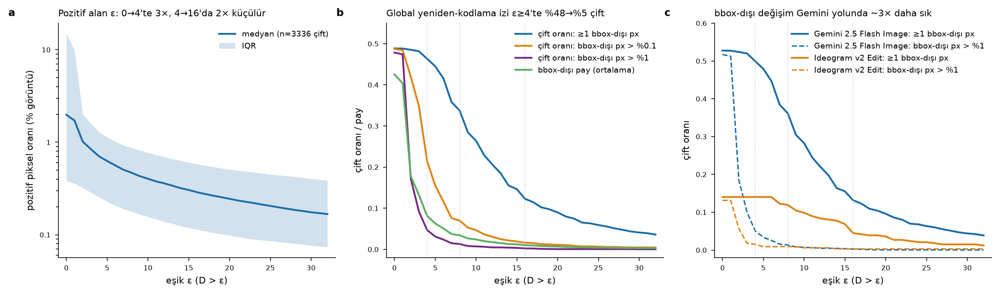
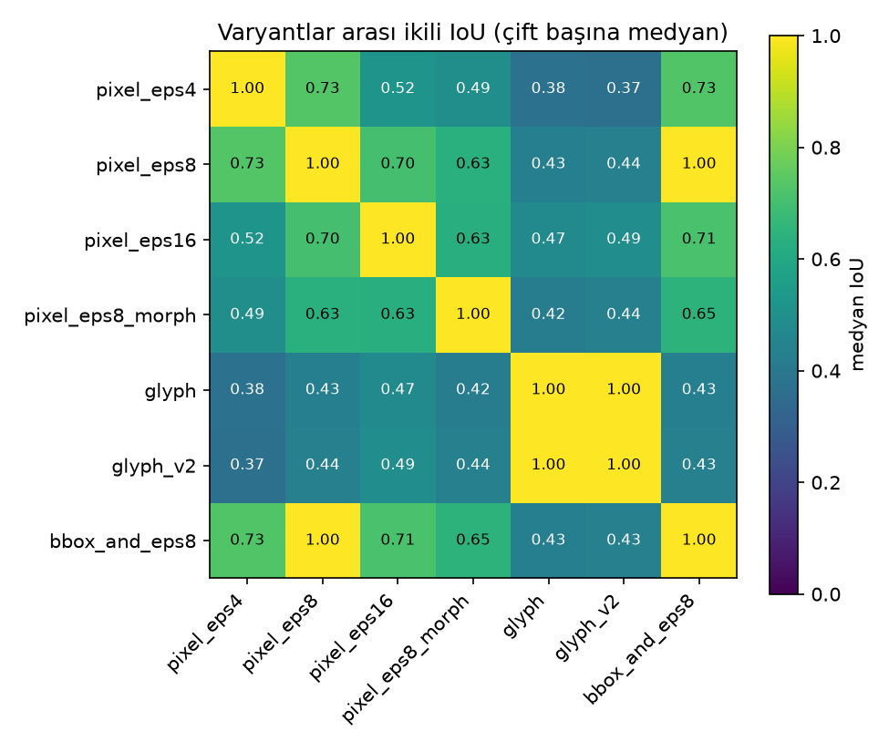
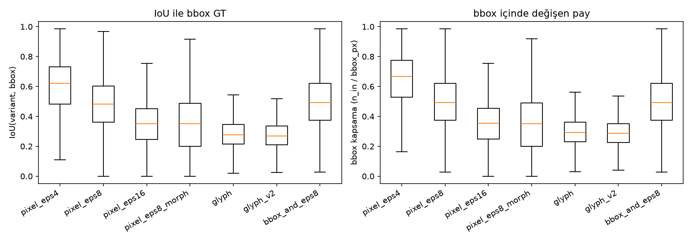

# Piksel-değişim GT varyantları — rapor (AIForge-Doc v1)

Üretim: `make_gt.py`. Çift sayısı: 3336 (işlenen 3336, atlanan 0). Split: {'training': 3247, 'testing': 89}.

D = max_kanal |forged − authentic|; bbox = maske dosyasından (rect). Pozitif oranlar görüntü pikseline göre; 'bbox kapsama' = bbox içindeki pozitif / bbox alanı; 'bbox-dışı pay' = bbox dışındaki pozitif / tüm pozitif.

Glif varyantında (spec kuralı: bbox içi medyan gri < 128) polarite ters çevrilen çift sayısı: **199** (kaynak kırılımı: {'cord': 78, 'sroie': 6, 'wildreceipt': 103, 'xfund': 12}) — ilk id'ler: 000000027, 000000031, 000000042, 000000057, 000000058, 000000062, 000000067, 000000071, 000000079, 000000085, 000000102, 000000107

**Uyarı:** medyan-gri kuralı loş/gölgeli fotoğraflarda (gri zemin, koyu metin) yanlış tetiklenir ve `glyph` maskesi metnin TÜMLEYENİNİ (zemini) seçer. Bu nedenle `glyph_v2` eklendi: polarite = 'metin azınlık sınıfı' (bbox içinde Sauvola-koyu oranı > 0.5 ise ters). glyph_v2'de ters çevrilen çift sayısı: **21** — id: 000000058, 000000242, 000000328, 000000395, 000000594, 000000719, 000000766, 000001024, 000001545, 000001553, 000002843, 000002958, 000002989, 000003031, 000003103, 000003109, 000003113, 000003115, 000003144, 000003149. Model eğitimi için `glyph_v2` önerilir; `glyph` spec uyumluluğu için saklanmıştır.

**Dejenere çiftler (D_max ≤ 4, forged ≈ authentic; sahtelik piksel düzeyinde görünmez):** 10 — 000000035(train,cord,D=0), 000000129(train,cord,D=0), 000000515(train,cord,D=0), 000000710(train,cord,D=0), 000001193(train,sroie,D=0), 000002526(train,wildreceipt,D=4), 000002946(train,xfund,D=0), 000002974(train,xfund,D=0), 000003018(train,xfund,D=0), 000000723(testi,wildreceipt,D=0)

**Tüm D>8 değişimi bbox DIŞINDA olan çiftler (bbox∩eps8 boş, eps8 dolu; anotasyon-değişim uyumsuzluğu):** 5 — 000000804(train,sroie,D=12,n=11), 000001361(train,sroie,D=13,n=25), 000002022(train,wildreceipt,D=9,n=3), 000002647(train,wildreceipt,D=16,n=85), 000002820(train,wildreceipt,D=21,n=2117)

## 1. Varyant başına özet (tüm işlenen çiftler)

| varyant | pozitif px medyan [IQR] | pozitif oran (görüntü) medyan | bbox kapsama medyan [IQR] | IoU(bbox) medyan [IQR] | bbox-dışı pay medyan / ort. | çift: ≥1 bbox-dışı px | bbox-dışı pay (3 px halo hariç) ort. | çift: ≥1 bbox-dışı px (halo hariç) | çift: bbox-dışı bileşen | bileşen sayısı medyan | boş maske | kapsama <%20 |
|---|---|---|---|---|---|---|---|---|---|---|---|---|
| pixel_eps4 | 4136 [1962–9689] | 0.6610% | 0.666 [0.529–0.774] | 0.620 [0.481–0.731] | 0.000 / 0.080 | 1538 (46.1%) | 0.079 | 1538 (46.1%) | 1538 | 67 [19–223] | 10 | 26 |
| pixel_eps8 | 2753 [1379–6443] | 0.4425% | 0.492 [0.374–0.620] | 0.481 [0.361–0.604] | 0.000 / 0.032 | 1117 (33.5%) | 0.032 | 1117 (33.5%) | 1117 | 51 [18–148] | 13 | 180 |
| pixel_eps16 | 1770 [887–4279] | 0.2727% | 0.354 [0.247–0.454] | 0.351 [0.245–0.452] | 0.000 / 0.009 | 403 (12.1%) | 0.009 | 403 (12.1%) | 403 | 33 [12–92] | 17 | 573 |
| pixel_eps8_morph | 1604 [763–4392] | 0.2269% | 0.351 [0.199–0.489] | 0.350 [0.199–0.486] | 0.000 / 0.007 | 161 (4.8%) | 0.007 | 156 (4.7%) | 156 | 8 [3–17] | 20 | 837 |
| glyph | 2138 [881–5266] | 0.3247% | 0.293 [0.229–0.362] | 0.276 [0.214–0.346] | 0.023 / 0.120 | 2281 (68.4%) | 0.085 | 1094 (32.8%) | 1887 | 27 [9–50] | 18 | 507 |
| glyph_v2 | 1918 [835–4977] | 0.3057% | 0.286 [0.225–0.350] | 0.269 [0.211–0.334] | 0.017 / 0.113 | 2216 (66.4%) | 0.086 | 1093 (32.8%) | 1914 | 28 [10–51] | 18 | 537 |
| bbox_and_eps8 | 2624 [1317–6271] | 0.4245% | 0.492 [0.374–0.620] | 0.492 [0.374–0.620] | 0.000 / 0.000 | 0 (0.0%) | 0.000 | 0 (0.0%) | 0 | 39 [13–115] | 18 | 180 |

## Kırılım: tool

| varyant | grup | n | bbox kapsama medyan | IoU(bbox) medyan | bbox-dışı pay medyan | çift oranı: ≥1 bbox-dışı px | boş |
|---|---|---|---|---|---|---|---|
| pixel_eps4 | gemini-nano | 3001 | 0.671 | 0.622 | 0.000 | 0.497 | 10 |
| pixel_eps4 | qwen-inpaint | 335 | 0.613 | 0.597 | 0.000 | 0.140 | 0 |
| pixel_eps8 | gemini-nano | 3001 | 0.494 | 0.482 | 0.000 | 0.359 | 13 |
| pixel_eps8 | qwen-inpaint | 335 | 0.478 | 0.476 | 0.000 | 0.119 | 0 |
| pixel_eps16 | gemini-nano | 3001 | 0.348 | 0.346 | 0.000 | 0.129 | 17 |
| pixel_eps16 | qwen-inpaint | 335 | 0.384 | 0.383 | 0.000 | 0.045 | 0 |
| pixel_eps8_morph | gemini-nano | 3001 | 0.344 | 0.343 | 0.000 | 0.051 | 20 |
| pixel_eps8_morph | qwen-inpaint | 335 | 0.424 | 0.424 | 0.000 | 0.021 | 0 |
| glyph | gemini-nano | 3001 | 0.289 | 0.271 | 0.029 | 0.702 | 18 |
| glyph | qwen-inpaint | 335 | 0.324 | 0.321 | 0.000 | 0.522 | 0 |
| glyph_v2 | gemini-nano | 3001 | 0.283 | 0.264 | 0.021 | 0.681 | 18 |
| glyph_v2 | qwen-inpaint | 335 | 0.323 | 0.321 | 0.000 | 0.513 | 0 |
| bbox_and_eps8 | gemini-nano | 3001 | 0.494 | 0.494 | 0.000 | 0.000 | 18 |
| bbox_and_eps8 | qwen-inpaint | 335 | 0.478 | 0.478 | 0.000 | 0.000 | 0 |

## Kırılım: kaynak

| varyant | grup | n | bbox kapsama medyan | IoU(bbox) medyan | bbox-dışı pay medyan | çift oranı: ≥1 bbox-dışı px | boş |
|---|---|---|---|---|---|---|---|
| pixel_eps4 | cord | 803 | 0.688 | 0.688 | 0.000 | 0.004 | 4 |
| pixel_eps4 | sroie | 755 | 0.555 | 0.521 | 0.000 | 0.416 | 1 |
| pixel_eps4 | wildreceipt | 1443 | 0.735 | 0.648 | 0.047 | 0.846 | 2 |
| pixel_eps4 | xfund | 335 | 0.492 | 0.492 | 0.000 | 0.000 | 3 |
| pixel_eps8 | cord | 803 | 0.505 | 0.505 | 0.000 | 0.004 | 4 |
| pixel_eps8 | sroie | 755 | 0.410 | 0.403 | 0.000 | 0.322 | 1 |
| pixel_eps8 | wildreceipt | 1443 | 0.565 | 0.536 | 0.001 | 0.604 | 5 |
| pixel_eps8 | xfund | 335 | 0.393 | 0.393 | 0.000 | 0.000 | 3 |
| pixel_eps16 | cord | 803 | 0.368 | 0.367 | 0.000 | 0.004 | 4 |
| pixel_eps16 | sroie | 755 | 0.290 | 0.289 | 0.000 | 0.110 | 3 |
| pixel_eps16 | wildreceipt | 1443 | 0.381 | 0.376 | 0.000 | 0.220 | 7 |
| pixel_eps16 | xfund | 335 | 0.332 | 0.332 | 0.000 | 0.000 | 3 |
| pixel_eps8_morph | cord | 803 | 0.415 | 0.412 | 0.000 | 0.004 | 4 |
| pixel_eps8_morph | sroie | 755 | 0.268 | 0.268 | 0.000 | 0.033 | 4 |
| pixel_eps8_morph | wildreceipt | 1443 | 0.362 | 0.360 | 0.000 | 0.092 | 8 |
| pixel_eps8_morph | xfund | 335 | 0.304 | 0.304 | 0.000 | 0.000 | 4 |
| glyph | cord | 803 | 0.289 | 0.287 | 0.000 | 0.360 | 8 |
| glyph | sroie | 755 | 0.268 | 0.259 | 0.004 | 0.710 | 1 |
| glyph | wildreceipt | 1443 | 0.298 | 0.263 | 0.125 | 0.896 | 6 |
| glyph | xfund | 335 | 0.332 | 0.331 | 0.000 | 0.487 | 3 |
| glyph_v2 | cord | 803 | 0.277 | 0.276 | 0.000 | 0.300 | 8 |
| glyph_v2 | sroie | 755 | 0.268 | 0.259 | 0.004 | 0.709 | 1 |
| glyph_v2 | wildreceipt | 1443 | 0.289 | 0.257 | 0.113 | 0.885 | 6 |
| glyph_v2 | xfund | 335 | 0.332 | 0.331 | 0.000 | 0.487 | 3 |
| bbox_and_eps8 | cord | 803 | 0.505 | 0.505 | 0.000 | 0.000 | 4 |
| bbox_and_eps8 | sroie | 755 | 0.410 | 0.410 | 0.000 | 0.000 | 3 |
| bbox_and_eps8 | wildreceipt | 1443 | 0.565 | 0.565 | 0.000 | 0.000 | 8 |
| bbox_and_eps8 | xfund | 335 | 0.393 | 0.393 | 0.000 | 0.000 | 3 |

## Kırılım: split

| varyant | grup | n | bbox kapsama medyan | IoU(bbox) medyan | bbox-dışı pay medyan | çift oranı: ≥1 bbox-dışı px | boş |
|---|---|---|---|---|---|---|---|
| pixel_eps4 | testing | 89 | 0.730 | 0.721 | 0.000 | 0.090 | 1 |
| pixel_eps4 | training | 3247 | 0.665 | 0.617 | 0.000 | 0.471 | 9 |
| pixel_eps8 | testing | 89 | 0.563 | 0.561 | 0.000 | 0.090 | 1 |
| pixel_eps8 | training | 3247 | 0.491 | 0.480 | 0.000 | 0.342 | 12 |
| pixel_eps16 | testing | 89 | 0.379 | 0.366 | 0.000 | 0.079 | 1 |
| pixel_eps16 | training | 3247 | 0.353 | 0.351 | 0.000 | 0.122 | 16 |
| pixel_eps8_morph | testing | 89 | 0.353 | 0.347 | 0.000 | 0.067 | 1 |
| pixel_eps8_morph | training | 3247 | 0.351 | 0.350 | 0.000 | 0.048 | 19 |
| glyph | testing | 89 | 0.272 | 0.258 | 0.039 | 0.719 | 1 |
| glyph | training | 3247 | 0.294 | 0.276 | 0.022 | 0.683 | 17 |
| glyph_v2 | testing | 89 | 0.269 | 0.258 | 0.035 | 0.708 | 1 |
| glyph_v2 | training | 3247 | 0.287 | 0.270 | 0.016 | 0.663 | 17 |
| bbox_and_eps8 | testing | 89 | 0.563 | 0.563 | 0.000 | 0.000 | 1 |
| bbox_and_eps8 | training | 3247 | 0.491 | 0.491 | 0.000 | 0.000 | 17 |

## 2. ε-duyarlılık (D>ε; histogram tabanlı, TÜM işlenen çiftler, n=3336)

(ham sürüm: fig_eps_sensitivity.png)

| ε | pozitif oran (görüntü) medyan | bbox kapsama medyan | IoU(bbox) medyan | bbox-dışı pay medyan | bbox-dışı pay ort. | çift oranı ≥1 bbox-dışı px | çift oranı bbox-dışı px >%0.1 | çift oranı bbox-dışı px >%1 |
|---|---|---|---|---|---|---|---|---|
| 0 | 1.9794% | 0.949 | 0.757 | 0.000 | 0.425 | 0.489 | 0.487 | 0.478 |
| 1 | 1.7138% | 0.894 | 0.534 | 0.000 | 0.404 | 0.488 | 0.484 | 0.474 |
| 2 | 1.0163% | 0.816 | 0.655 | 0.000 | 0.178 | 0.485 | 0.420 | 0.172 |
| 3 | 0.8438% | 0.739 | 0.637 | 0.000 | 0.132 | 0.482 | 0.348 | 0.092 |
| 4 | 0.7044% | 0.669 | 0.620 | 0.000 | 0.082 | 0.463 | 0.215 | 0.047 |
| 6 | 0.5617% | 0.565 | 0.540 | 0.000 | 0.051 | 0.416 | 0.116 | 0.024 |
| 8 | 0.4678% | 0.494 | 0.482 | 0.000 | 0.034 | 0.337 | 0.070 | 0.013 |
| 12 | 0.3592% | 0.405 | 0.400 | 0.000 | 0.017 | 0.206 | 0.031 | 0.005 |
| 16 | 0.2887% | 0.353 | 0.351 | 0.000 | 0.010 | 0.123 | 0.016 | 0.002 |
| 24 | 0.2119% | 0.289 | 0.288 | 0.000 | 0.005 | 0.063 | 0.007 | 0.001 |
| 32 | 0.1674% | 0.246 | 0.245 | 0.000 | 0.003 | 0.036 | 0.004 | 0.000 |

**Yeniden-kodlama izi (ε=0'daki global ±1–3 fark) ε≥4'te kayboluyor mu?** ε=0'da çiftlerin 47.8%'inde bbox-dışı piksellerin >%1'i değişmiş (medyan bbox-dışı pay 0.000); ε=4'te bu oran 4.7% (medyan pay 0.000), ε=8'de 1.3% (0.000), ε=16'da 0.2% (0.000). ≥1 bbox-dışı piksel içeren çift oranı: ε=0 0.489 → ε=4 0.463 → ε=8 0.337 → ε=16 0.123.

Not: ε=0–1'de IoU(bbox) ve bbox-dışı pay medyanları bimodal dağılım (çiftlerin ~%49'unda global yeniden-kodlama izi var, ~%51'inde hiç yok) nedeniyle kararsızdır; ortalama ve 'çift oranı' sütunları daha bilgilendiricidir.

Tool kırılımı (çift oranı: ≥1 bbox-dışı px / bbox-dışı pay medyan):

| ε | gemini-nano | qwen-inpaint |
|---|---|---|
| 0 | 0.527 / 0.644 | 0.140 / 0.000 |
| 2 | 0.524 / 0.020 | 0.140 / 0.000 |
| 4 | 0.500 / 0.000 | 0.140 / 0.000 |
| 8 | 0.362 / 0.000 | 0.119 / 0.000 |
| 16 | 0.132 / 0.000 | 0.045 / 0.000 |
| 32 | 0.039 / 0.000 | 0.012 / 0.000 |

## 3. Varyantlar arası ikili IoU (çift başına medyan)

| | pixel_eps4 | pixel_eps8 | pixel_eps16 | pixel_eps8_morph | glyph | glyph_v2 | bbox_and_eps8 |
|---|---|---|---|---|---|---|---|
| pixel_eps4 | 1.000 | 0.731 | 0.516 | 0.493 | 0.376 | 0.369 | 0.728 |
| pixel_eps8 | 0.731 | 1.000 | 0.705 | 0.634 | 0.432 | 0.436 | 1.000 |
| pixel_eps16 | 0.516 | 0.705 | 1.000 | 0.630 | 0.475 | 0.491 | 0.714 |
| pixel_eps8_morph | 0.493 | 0.634 | 0.630 | 1.000 | 0.425 | 0.436 | 0.647 |
| glyph | 0.376 | 0.432 | 0.475 | 0.425 | 1.000 | 1.000 | 0.431 |
| glyph_v2 | 0.369 | 0.436 | 0.491 | 0.436 | 1.000 | 1.000 | 0.435 |
| bbox_and_eps8 | 0.728 | 1.000 | 0.714 | 0.647 | 0.431 | 0.435 | 1.000 |

## 4. Notlar

- `glyph`: Sauvola (skimage.filters.threshold_sauvola, window_size=25, k=0.2) ile forged ve authentic gri görüntülerde metin pikselleri (gri < eşik) birleştirilip dilate(D>8, 3×3 kare, 3 iterasyon = 3 px yarıçap) ile kesiştirildi.
- `pixel_eps8_morph`: cv2 MORPH_OPEN 3×3 → 8-komşuluk bağlı bileşen alanı <8 px olanlar atıldı → MORPH_CLOSE 3×3.
- 'bbox-dışı bileşen' = varyantın bbox ile hiç kesişmeyen 8-komşuluk bağlı bileşeni. '3 px halo hariç' = bbox'ın 3 px genişletilmişinin dışında kalan pozitifler (glif varyantlarının bbox kenarına taşan dilate halosu bu sayımda yok sayılır).
- `glyph_v2`: `glyph` ile aynı işlem; polarite kuralı 'bbox içinde Sauvola-koyu piksel oranı > 0.5 ise ters' (metin azınlık sınıfı).
- Dosya düzeni: training maskeleri `<variant>/<new_id>.png`, testing maskeleri `<variant>/test/<new_id>.png` (TestingSet new_id'leri 1–812 TrainingSet id'leriyle çakıştığı için ayrı alt klasör; `gt_index.csv` → `gt_relpath`).
- Atlanan çiftler: yok