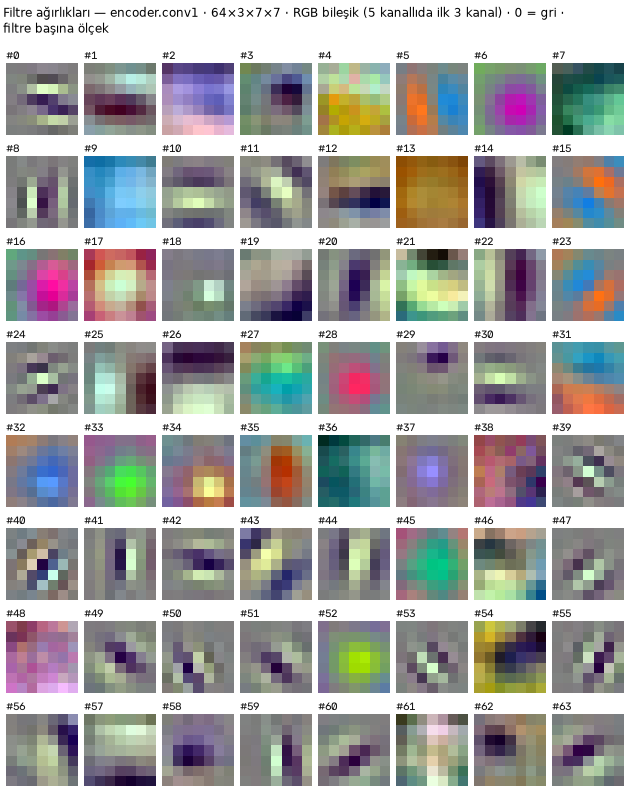
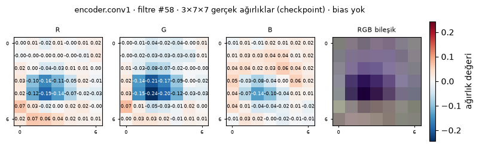
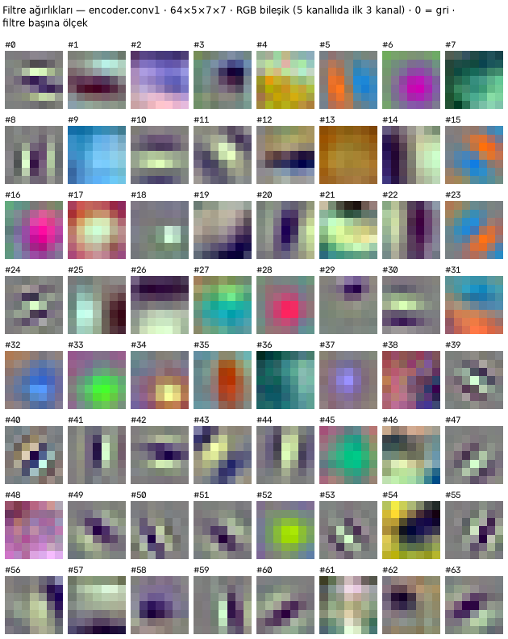
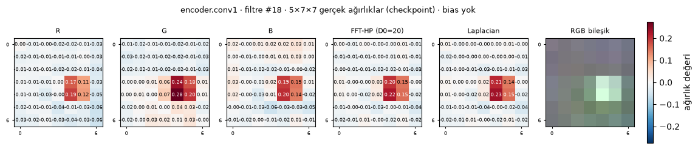
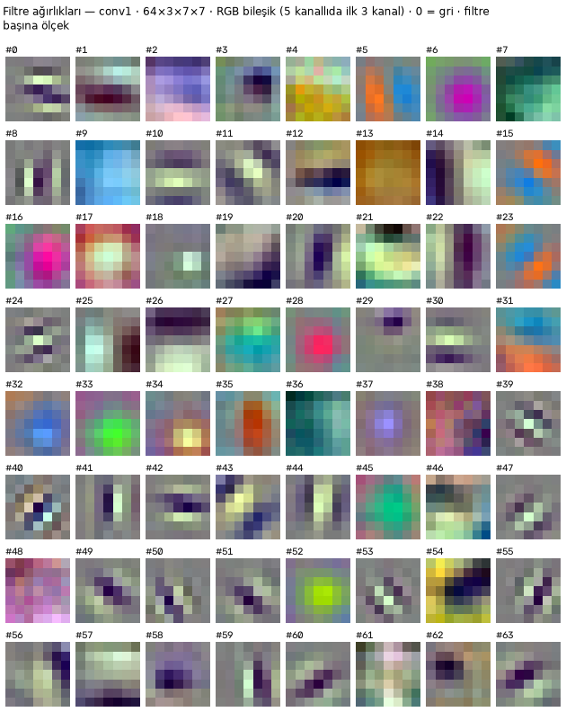
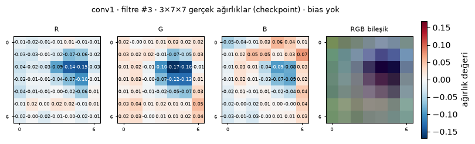
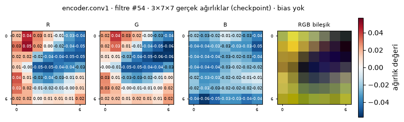
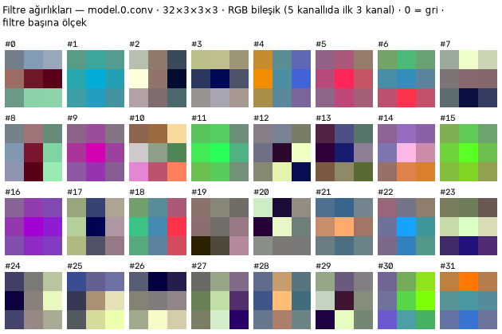
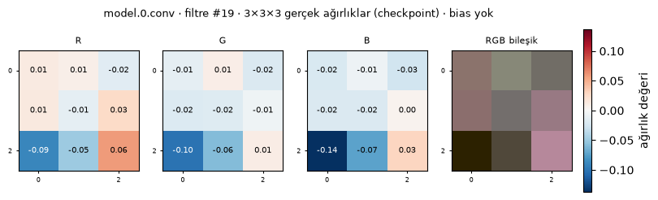

# XAI · Katman Filtreleri (Filter Visualization) — model raporu

> Not: Veri setinden türetilen görseller (filtre↔harita çiftleri, aktivasyon grid'leri, karşılaştırmalar) AIForge-Doc lisansı
> gereği depoda tutulmaz; yalnız kernel ağırlık görselleri vardır. Tümü `python tools\xai_filter_report.py` ile yerelde üretilir.

Tarih: 09.11.2026 19:00 · test görüntüsü `000000001.png` (TestingSet, GT kutusu merkezli 512 px natif kırpma) · cihaz CPU (GPU eğitimde) · test: **55 kontrol / 0 hata** (67.6 s)

Kernel'ler checkpoint dosyalarından okunur; yeni filtre eğitilmez/üretilmez. Ara çıktılar modelin kendi forward'ından kancalarla alınır; her conv katmanı checkpoint kernel'iyle bağımsız `F.conv2d` ile yeniden hesaplanıp modelin çıktısıyla karşılaştırılır. İlk katman kuralı: yürütme sırasındaki Conv2d'ler, çıkış çözünürlüğü ≥ girdinin 1/4'ü olduğu sürece (en fazla 6); forward bu noktada durdurulur.

## Model başına özet

| Model | Mimari (otomatik tespit) | Ön işleme | İlk katmanlar (ad · filtre×giriş×kernel · stride · çözünürlük) | Filtre sayısı | Kernel boyutları | Aktivasyon haritası | En kötü göreli Δ | Ağırlık/dosya değişmedi | Test |
|---|---|---|---|---|---|---|---|---|---|
| `PHASE2/dlv3p_bbox_s42` | smp.DeepLabV3Plus(encoder=resnet18, in_channels=3, classes=1) | imagenet (3 kanal) | `encoder.conv1` 64×3×7×7 · s2 · 1/2 · conv→norm→act `encoder.layer1.0.conv1` 64×64×3×3 · s1 · 1/4 · conv→norm→act `encoder.layer1.0.conv2` 64×64×3×3 · s1 · 1/4 · conv→norm `encoder.layer1.1.conv1` 64×64×3×3 · s1 · 1/4 · conv→norm→act `encoder.layer1.1.conv2` 64×64×3×3 · s1 · 1/4 · conv→norm | 64 + 64 + 64 + 64 + 64 | 3×3, 7×7 | 832 | 1.2e-06 | ✓ | ✅ |
| `PHASE2/dlv3p_glyph_v2_s42` | smp.DeepLabV3Plus(encoder=resnet18, in_channels=3, classes=1) | imagenet (3 kanal) | `encoder.conv1` 64×3×7×7 · s2 · 1/2 · conv→norm→act `encoder.layer1.0.conv1` 64×64×3×3 · s1 · 1/4 · conv→norm→act `encoder.layer1.0.conv2` 64×64×3×3 · s1 · 1/4 · conv→norm `encoder.layer1.1.conv1` 64×64×3×3 · s1 · 1/4 · conv→norm→act `encoder.layer1.1.conv2` 64×64×3×3 · s1 · 1/4 · conv→norm | 64 + 64 + 64 + 64 + 64 | 3×3, 7×7 | 832 | 1.2e-06 | ✓ | ✅ |
| `PHASE2/dlv3p_pixel_eps8_morph_s42` | smp.DeepLabV3Plus(encoder=resnet18, in_channels=3, classes=1) | imagenet (3 kanal) | `encoder.conv1` 64×3×7×7 · s2 · 1/2 · conv→norm→act `encoder.layer1.0.conv1` 64×64×3×3 · s1 · 1/4 · conv→norm→act `encoder.layer1.0.conv2` 64×64×3×3 · s1 · 1/4 · conv→norm `encoder.layer1.1.conv1` 64×64×3×3 · s1 · 1/4 · conv→norm→act `encoder.layer1.1.conv2` 64×64×3×3 · s1 · 1/4 · conv→norm | 64 + 64 + 64 + 64 + 64 | 3×3, 7×7 | 832 | 1.1e-06 | ✓ | ✅ |
| `PHASE2/h4_resnet18` | torchvision.resnet18 (fc → 1) | imagenet (3 kanal) | `conv1` 64×3×7×7 · s2 · 1/2 · conv→norm→act `layer1.0.conv1` 64×64×3×3 · s1 · 1/4 · conv→norm→act `layer1.0.conv2` 64×64×3×3 · s1 · 1/4 · conv→norm `layer1.1.conv1` 64×64×3×3 · s1 · 1/4 · conv→norm→act `layer1.1.conv2` 64×64×3×3 · s1 · 1/4 · conv→norm | 64 + 64 + 64 + 64 + 64 | 3×3, 7×7 | 832 | 9.5e-07 | ✓ | ✅ |
| `PHASE2/h4_resnet18_poscontrol` | torchvision.resnet18 (fc → 1) | imagenet (3 kanal) | `conv1` 64×3×7×7 · s2 · 1/2 · conv→norm→act `layer1.0.conv1` 64×64×3×3 · s1 · 1/4 · conv→norm→act `layer1.0.conv2` 64×64×3×3 · s1 · 1/4 · conv→norm `layer1.1.conv1` 64×64×3×3 · s1 · 1/4 · conv→norm→act `layer1.1.conv2` 64×64×3×3 · s1 · 1/4 · conv→norm | 64 + 64 + 64 + 64 + 64 | 3×3, 7×7 | 832 | 9.9e-07 | ✓ | ✅ |
| `PHASE2/unet_bbox_geminionly_s42` | smp.Unet(encoder=resnet18, in_channels=3, classes=1) | imagenet (3 kanal) | `encoder.conv1` 64×3×7×7 · s2 · 1/2 · conv→norm→act `encoder.layer1.0.conv1` 64×64×3×3 · s1 · 1/4 · conv→norm→act `encoder.layer1.0.conv2` 64×64×3×3 · s1 · 1/4 · conv→norm `encoder.layer1.1.conv1` 64×64×3×3 · s1 · 1/4 · conv→norm→act `encoder.layer1.1.conv2` 64×64×3×3 · s1 · 1/4 · conv→norm | 64 + 64 + 64 + 64 + 64 | 3×3, 7×7 | 832 | 1.3e-06 | ✓ | ✅ |
| `PHASE2/unet_bbox_geminionly_s43` | smp.Unet(encoder=resnet18, in_channels=3, classes=1) | imagenet (3 kanal) | `encoder.conv1` 64×3×7×7 · s2 · 1/2 · conv→norm→act `encoder.layer1.0.conv1` 64×64×3×3 · s1 · 1/4 · conv→norm→act `encoder.layer1.0.conv2` 64×64×3×3 · s1 · 1/4 · conv→norm `encoder.layer1.1.conv1` 64×64×3×3 · s1 · 1/4 · conv→norm→act `encoder.layer1.1.conv2` 64×64×3×3 · s1 · 1/4 · conv→norm | 64 + 64 + 64 + 64 + 64 | 3×3, 7×7 | 832 | 1.1e-06 | ✓ | ✅ |
| `PHASE2/unet_bbox_geminionly_s44` | smp.Unet(encoder=resnet18, in_channels=3, classes=1) | imagenet (3 kanal) | `encoder.conv1` 64×3×7×7 · s2 · 1/2 · conv→norm→act `encoder.layer1.0.conv1` 64×64×3×3 · s1 · 1/4 · conv→norm→act `encoder.layer1.0.conv2` 64×64×3×3 · s1 · 1/4 · conv→norm `encoder.layer1.1.conv1` 64×64×3×3 · s1 · 1/4 · conv→norm→act `encoder.layer1.1.conv2` 64×64×3×3 · s1 · 1/4 · conv→norm | 64 + 64 + 64 + 64 + 64 | 3×3, 7×7 | 832 | 9.0e-07 | ✓ | ✅ |
| `PHASE2/unet_bbox_mr_s42` | smp.Unet(encoder=resnet18, in_channels=3, classes=1) | imagenet (3 kanal) | `encoder.conv1` 64×3×7×7 · s2 · 1/2 · conv→norm→act `encoder.layer1.0.conv1` 64×64×3×3 · s1 · 1/4 · conv→norm→act `encoder.layer1.0.conv2` 64×64×3×3 · s1 · 1/4 · conv→norm `encoder.layer1.1.conv1` 64×64×3×3 · s1 · 1/4 · conv→norm→act `encoder.layer1.1.conv2` 64×64×3×3 · s1 · 1/4 · conv→norm | 64 + 64 + 64 + 64 + 64 | 3×3, 7×7 | 832 | 9.8e-07 | ✓ | ✅ |
| `PHASE2/unet_bbox_s42` | smp.Unet(encoder=resnet18, in_channels=3, classes=1) | imagenet (3 kanal) | `encoder.conv1` 64×3×7×7 · s2 · 1/2 · conv→norm→act `encoder.layer1.0.conv1` 64×64×3×3 · s1 · 1/4 · conv→norm→act `encoder.layer1.0.conv2` 64×64×3×3 · s1 · 1/4 · conv→norm `encoder.layer1.1.conv1` 64×64×3×3 · s1 · 1/4 · conv→norm→act `encoder.layer1.1.conv2` 64×64×3×3 · s1 · 1/4 · conv→norm | 64 + 64 + 64 + 64 + 64 | 3×3, 7×7 | 832 | 8.9e-07 | ✓ | ✅ |
| `PHASE2/unet_bbox_s42_e20` | smp.Unet(encoder=resnet18, in_channels=3, classes=1) | imagenet (3 kanal) | `encoder.conv1` 64×3×7×7 · s2 · 1/2 · conv→norm→act `encoder.layer1.0.conv1` 64×64×3×3 · s1 · 1/4 · conv→norm→act `encoder.layer1.0.conv2` 64×64×3×3 · s1 · 1/4 · conv→norm `encoder.layer1.1.conv1` 64×64×3×3 · s1 · 1/4 · conv→norm→act `encoder.layer1.1.conv2` 64×64×3×3 · s1 · 1/4 · conv→norm | 64 + 64 + 64 + 64 + 64 | 3×3, 7×7 | 832 | 1.0e-06 | ✓ | ✅ |
| `PHASE2/unet_bbox_s43` | smp.Unet(encoder=resnet18, in_channels=3, classes=1) | imagenet (3 kanal) | `encoder.conv1` 64×3×7×7 · s2 · 1/2 · conv→norm→act `encoder.layer1.0.conv1` 64×64×3×3 · s1 · 1/4 · conv→norm→act `encoder.layer1.0.conv2` 64×64×3×3 · s1 · 1/4 · conv→norm `encoder.layer1.1.conv1` 64×64×3×3 · s1 · 1/4 · conv→norm→act `encoder.layer1.1.conv2` 64×64×3×3 · s1 · 1/4 · conv→norm | 64 + 64 + 64 + 64 + 64 | 3×3, 7×7 | 832 | 1.1e-06 | ✓ | ✅ |
| `PHASE2/unet_bbox_s44` | smp.Unet(encoder=resnet18, in_channels=3, classes=1) | imagenet (3 kanal) | `encoder.conv1` 64×3×7×7 · s2 · 1/2 · conv→norm→act `encoder.layer1.0.conv1` 64×64×3×3 · s1 · 1/4 · conv→norm→act `encoder.layer1.0.conv2` 64×64×3×3 · s1 · 1/4 · conv→norm `encoder.layer1.1.conv1` 64×64×3×3 · s1 · 1/4 · conv→norm→act `encoder.layer1.1.conv2` 64×64×3×3 · s1 · 1/4 · conv→norm | 64 + 64 + 64 + 64 + 64 | 3×3, 7×7 | 832 | 1.1e-06 | ✓ | ✅ |
| `PHASE2/unet_glyph_v2_geminionly_s42` | smp.Unet(encoder=resnet18, in_channels=3, classes=1) | imagenet (3 kanal) | `encoder.conv1` 64×3×7×7 · s2 · 1/2 · conv→norm→act `encoder.layer1.0.conv1` 64×64×3×3 · s1 · 1/4 · conv→norm→act `encoder.layer1.0.conv2` 64×64×3×3 · s1 · 1/4 · conv→norm `encoder.layer1.1.conv1` 64×64×3×3 · s1 · 1/4 · conv→norm→act `encoder.layer1.1.conv2` 64×64×3×3 · s1 · 1/4 · conv→norm | 64 + 64 + 64 + 64 + 64 | 3×3, 7×7 | 832 | 1.0e-06 | ✓ | ✅ |
| `PHASE2/unet_glyph_v2_geminionly_s43` | smp.Unet(encoder=resnet18, in_channels=3, classes=1) | imagenet (3 kanal) | `encoder.conv1` 64×3×7×7 · s2 · 1/2 · conv→norm→act `encoder.layer1.0.conv1` 64×64×3×3 · s1 · 1/4 · conv→norm→act `encoder.layer1.0.conv2` 64×64×3×3 · s1 · 1/4 · conv→norm `encoder.layer1.1.conv1` 64×64×3×3 · s1 · 1/4 · conv→norm→act `encoder.layer1.1.conv2` 64×64×3×3 · s1 · 1/4 · conv→norm | 64 + 64 + 64 + 64 + 64 | 3×3, 7×7 | 832 | 9.9e-07 | ✓ | ✅ |
| `PHASE2/unet_glyph_v2_geminionly_s44` | smp.Unet(encoder=resnet18, in_channels=3, classes=1) | imagenet (3 kanal) | `encoder.conv1` 64×3×7×7 · s2 · 1/2 · conv→norm→act `encoder.layer1.0.conv1` 64×64×3×3 · s1 · 1/4 · conv→norm→act `encoder.layer1.0.conv2` 64×64×3×3 · s1 · 1/4 · conv→norm `encoder.layer1.1.conv1` 64×64×3×3 · s1 · 1/4 · conv→norm→act `encoder.layer1.1.conv2` 64×64×3×3 · s1 · 1/4 · conv→norm | 64 + 64 + 64 + 64 + 64 | 3×3, 7×7 | 832 | 1.2e-06 | ✓ | ✅ |
| `PHASE2/unet_glyph_v2_nm_mr_s42` | smp.Unet(encoder=resnet18, in_channels=3, classes=1) | imagenet (3 kanal) | `encoder.conv1` 64×3×7×7 · s2 · 1/2 · conv→norm→act `encoder.layer1.0.conv1` 64×64×3×3 · s1 · 1/4 · conv→norm→act `encoder.layer1.0.conv2` 64×64×3×3 · s1 · 1/4 · conv→norm `encoder.layer1.1.conv1` 64×64×3×3 · s1 · 1/4 · conv→norm→act `encoder.layer1.1.conv2` 64×64×3×3 · s1 · 1/4 · conv→norm | 64 + 64 + 64 + 64 + 64 | 3×3, 7×7 | 832 | 8.5e-07 | ✓ | ✅ |
| `PHASE2/unet_glyph_v2_s42` | smp.Unet(encoder=resnet18, in_channels=3, classes=1) | imagenet (3 kanal) | `encoder.conv1` 64×3×7×7 · s2 · 1/2 · conv→norm→act `encoder.layer1.0.conv1` 64×64×3×3 · s1 · 1/4 · conv→norm→act `encoder.layer1.0.conv2` 64×64×3×3 · s1 · 1/4 · conv→norm `encoder.layer1.1.conv1` 64×64×3×3 · s1 · 1/4 · conv→norm→act `encoder.layer1.1.conv2` 64×64×3×3 · s1 · 1/4 · conv→norm | 64 + 64 + 64 + 64 + 64 | 3×3, 7×7 | 832 | 9.7e-07 | ✓ | ✅ |
| `PHASE2/unet_glyph_v2_s42_e20` | smp.Unet(encoder=resnet18, in_channels=3, classes=1) | imagenet (3 kanal) | `encoder.conv1` 64×3×7×7 · s2 · 1/2 · conv→norm→act `encoder.layer1.0.conv1` 64×64×3×3 · s1 · 1/4 · conv→norm→act `encoder.layer1.0.conv2` 64×64×3×3 · s1 · 1/4 · conv→norm `encoder.layer1.1.conv1` 64×64×3×3 · s1 · 1/4 · conv→norm→act `encoder.layer1.1.conv2` 64×64×3×3 · s1 · 1/4 · conv→norm | 64 + 64 + 64 + 64 + 64 | 3×3, 7×7 | 832 | 8.8e-07 | ✓ | ✅ |
| `PHASE2/unet_glyph_v2_s43` | smp.Unet(encoder=resnet18, in_channels=3, classes=1) | imagenet (3 kanal) | `encoder.conv1` 64×3×7×7 · s2 · 1/2 · conv→norm→act `encoder.layer1.0.conv1` 64×64×3×3 · s1 · 1/4 · conv→norm→act `encoder.layer1.0.conv2` 64×64×3×3 · s1 · 1/4 · conv→norm `encoder.layer1.1.conv1` 64×64×3×3 · s1 · 1/4 · conv→norm→act `encoder.layer1.1.conv2` 64×64×3×3 · s1 · 1/4 · conv→norm | 64 + 64 + 64 + 64 + 64 | 3×3, 7×7 | 832 | 8.8e-07 | ✓ | ✅ |
| `PHASE2/unet_glyph_v2_s44` | smp.Unet(encoder=resnet18, in_channels=3, classes=1) | imagenet (3 kanal) | `encoder.conv1` 64×3×7×7 · s2 · 1/2 · conv→norm→act `encoder.layer1.0.conv1` 64×64×3×3 · s1 · 1/4 · conv→norm→act `encoder.layer1.0.conv2` 64×64×3×3 · s1 · 1/4 · conv→norm `encoder.layer1.1.conv1` 64×64×3×3 · s1 · 1/4 · conv→norm→act `encoder.layer1.1.conv2` 64×64×3×3 · s1 · 1/4 · conv→norm | 64 + 64 + 64 + 64 + 64 | 3×3, 7×7 | 832 | 1.1e-06 | ✓ | ✅ |
| `PHASE2/unet_pixel_eps8_morph_geminionly_s42` | smp.Unet(encoder=resnet18, in_channels=3, classes=1) | imagenet (3 kanal) | `encoder.conv1` 64×3×7×7 · s2 · 1/2 · conv→norm→act `encoder.layer1.0.conv1` 64×64×3×3 · s1 · 1/4 · conv→norm→act `encoder.layer1.0.conv2` 64×64×3×3 · s1 · 1/4 · conv→norm `encoder.layer1.1.conv1` 64×64×3×3 · s1 · 1/4 · conv→norm→act `encoder.layer1.1.conv2` 64×64×3×3 · s1 · 1/4 · conv→norm | 64 + 64 + 64 + 64 + 64 | 3×3, 7×7 | 832 | 8.7e-07 | ✓ | ✅ |
| `PHASE2/unet_pixel_eps8_morph_geminionly_s43` | smp.Unet(encoder=resnet18, in_channels=3, classes=1) | imagenet (3 kanal) | `encoder.conv1` 64×3×7×7 · s2 · 1/2 · conv→norm→act `encoder.layer1.0.conv1` 64×64×3×3 · s1 · 1/4 · conv→norm→act `encoder.layer1.0.conv2` 64×64×3×3 · s1 · 1/4 · conv→norm `encoder.layer1.1.conv1` 64×64×3×3 · s1 · 1/4 · conv→norm→act `encoder.layer1.1.conv2` 64×64×3×3 · s1 · 1/4 · conv→norm | 64 + 64 + 64 + 64 + 64 | 3×3, 7×7 | 832 | 1.0e-06 | ✓ | ✅ |
| `PHASE2/unet_pixel_eps8_morph_geminionly_s44` | smp.Unet(encoder=resnet18, in_channels=3, classes=1) | imagenet (3 kanal) | `encoder.conv1` 64×3×7×7 · s2 · 1/2 · conv→norm→act `encoder.layer1.0.conv1` 64×64×3×3 · s1 · 1/4 · conv→norm→act `encoder.layer1.0.conv2` 64×64×3×3 · s1 · 1/4 · conv→norm `encoder.layer1.1.conv1` 64×64×3×3 · s1 · 1/4 · conv→norm→act `encoder.layer1.1.conv2` 64×64×3×3 · s1 · 1/4 · conv→norm | 64 + 64 + 64 + 64 + 64 | 3×3, 7×7 | 832 | 9.1e-07 | ✓ | ✅ |
| `PHASE2/unet_pixel_eps8_morph_nm_mr_s42` | smp.Unet(encoder=resnet18, in_channels=3, classes=1) | imagenet (3 kanal) | `encoder.conv1` 64×3×7×7 · s2 · 1/2 · conv→norm→act `encoder.layer1.0.conv1` 64×64×3×3 · s1 · 1/4 · conv→norm→act `encoder.layer1.0.conv2` 64×64×3×3 · s1 · 1/4 · conv→norm `encoder.layer1.1.conv1` 64×64×3×3 · s1 · 1/4 · conv→norm→act `encoder.layer1.1.conv2` 64×64×3×3 · s1 · 1/4 · conv→norm | 64 + 64 + 64 + 64 + 64 | 3×3, 7×7 | 832 | 9.8e-07 | ✓ | ✅ |
| `PHASE2/unet_pixel_eps8_morph_s42` | smp.Unet(encoder=resnet18, in_channels=3, classes=1) | imagenet (3 kanal) | `encoder.conv1` 64×3×7×7 · s2 · 1/2 · conv→norm→act `encoder.layer1.0.conv1` 64×64×3×3 · s1 · 1/4 · conv→norm→act `encoder.layer1.0.conv2` 64×64×3×3 · s1 · 1/4 · conv→norm `encoder.layer1.1.conv1` 64×64×3×3 · s1 · 1/4 · conv→norm→act `encoder.layer1.1.conv2` 64×64×3×3 · s1 · 1/4 · conv→norm | 64 + 64 + 64 + 64 + 64 | 3×3, 7×7 | 832 | 9.9e-07 | ✓ | ✅ |
| `PHASE2/unet_pixel_eps8_morph_s42_e20` | smp.Unet(encoder=resnet18, in_channels=3, classes=1) | imagenet (3 kanal) | `encoder.conv1` 64×3×7×7 · s2 · 1/2 · conv→norm→act `encoder.layer1.0.conv1` 64×64×3×3 · s1 · 1/4 · conv→norm→act `encoder.layer1.0.conv2` 64×64×3×3 · s1 · 1/4 · conv→norm `encoder.layer1.1.conv1` 64×64×3×3 · s1 · 1/4 · conv→norm→act `encoder.layer1.1.conv2` 64×64×3×3 · s1 · 1/4 · conv→norm | 64 + 64 + 64 + 64 + 64 | 3×3, 7×7 | 832 | 8.8e-07 | ✓ | ✅ |
| `PHASE2/unet_pixel_eps8_morph_s43` | smp.Unet(encoder=resnet18, in_channels=3, classes=1) | imagenet (3 kanal) | `encoder.conv1` 64×3×7×7 · s2 · 1/2 · conv→norm→act `encoder.layer1.0.conv1` 64×64×3×3 · s1 · 1/4 · conv→norm→act `encoder.layer1.0.conv2` 64×64×3×3 · s1 · 1/4 · conv→norm `encoder.layer1.1.conv1` 64×64×3×3 · s1 · 1/4 · conv→norm→act `encoder.layer1.1.conv2` 64×64×3×3 · s1 · 1/4 · conv→norm | 64 + 64 + 64 + 64 + 64 | 3×3, 7×7 | 832 | 1.0e-06 | ✓ | ✅ |
| `PHASE2/unet_pixel_eps8_morph_s44` | smp.Unet(encoder=resnet18, in_channels=3, classes=1) | imagenet (3 kanal) | `encoder.conv1` 64×3×7×7 · s2 · 1/2 · conv→norm→act `encoder.layer1.0.conv1` 64×64×3×3 · s1 · 1/4 · conv→norm→act `encoder.layer1.0.conv2` 64×64×3×3 · s1 · 1/4 · conv→norm `encoder.layer1.1.conv1` 64×64×3×3 · s1 · 1/4 · conv→norm→act `encoder.layer1.1.conv2` 64×64×3×3 · s1 · 1/4 · conv→norm | 64 + 64 + 64 + 64 + 64 | 3×3, 7×7 | 832 | 1.1e-06 | ✓ | ✅ |
| `PHASE2/unetjoint_glyph_v2_s42` | smp.Unet(encoder=resnet18, in_channels=3, classes=2) | imagenet (3 kanal) | `encoder.conv1` 64×3×7×7 · s2 · 1/2 · conv→norm→act `encoder.layer1.0.conv1` 64×64×3×3 · s1 · 1/4 · conv→norm→act `encoder.layer1.0.conv2` 64×64×3×3 · s1 · 1/4 · conv→norm `encoder.layer1.1.conv1` 64×64×3×3 · s1 · 1/4 · conv→norm→act `encoder.layer1.1.conv2` 64×64×3×3 · s1 · 1/4 · conv→norm | 64 + 64 + 64 + 64 + 64 | 3×3, 7×7 | 832 | 9.2e-07 | ✓ | ✅ |
| `PHASE2/unetjoint_pixel_eps8_morph_s42` | smp.Unet(encoder=resnet18, in_channels=3, classes=2) | imagenet (3 kanal) | `encoder.conv1` 64×3×7×7 · s2 · 1/2 · conv→norm→act `encoder.layer1.0.conv1` 64×64×3×3 · s1 · 1/4 · conv→norm→act `encoder.layer1.0.conv2` 64×64×3×3 · s1 · 1/4 · conv→norm `encoder.layer1.1.conv1` 64×64×3×3 · s1 · 1/4 · conv→norm→act `encoder.layer1.1.conv2` 64×64×3×3 · s1 · 1/4 · conv→norm | 64 + 64 + 64 + 64 + 64 | 3×3, 7×7 | 832 | 1.2e-06 | ✓ | ✅ |
| `PHASE1/resnet18_ft_best` | torchvision.resnet18 (fc → 1) | imagenet (3 kanal) | `conv1` 64×3×7×7 · s2 · 1/2 · conv→norm→act `layer1.0.conv1` 64×64×3×3 · s1 · 1/4 · conv→norm→act `layer1.0.conv2` 64×64×3×3 · s1 · 1/4 · conv→norm `layer1.1.conv1` 64×64×3×3 · s1 · 1/4 · conv→norm→act `layer1.1.conv2` 64×64×3×3 · s1 · 1/4 · conv→norm | 64 + 64 + 64 + 64 + 64 | 3×3, 7×7 | 832 | 8.7e-07 | ✓ | ✅ |
| `PHASE1/resnet18_probe_best` | torchvision.resnet18 (fc → 1) | imagenet (3 kanal) | `conv1` 64×3×7×7 · s2 · 1/2 · conv→norm→act `layer1.0.conv1` 64×64×3×3 · s1 · 1/4 · conv→norm→act `layer1.0.conv2` 64×64×3×3 · s1 · 1/4 · conv→norm `layer1.1.conv1` 64×64×3×3 · s1 · 1/4 · conv→norm→act `layer1.1.conv2` 64×64×3×3 · s1 · 1/4 · conv→norm | 64 + 64 + 64 + 64 + 64 | 3×3, 7×7 | 832 | 9.9e-07 | ✓ | ✅ |
| `PHASE1/resnet18_scratch_best` | torchvision.resnet18 (fc → 1) | imagenet (3 kanal) | `conv1` 64×3×7×7 · s2 · 1/2 · conv→norm→act `layer1.0.conv1` 64×64×3×3 · s1 · 1/4 · conv→norm→act `layer1.0.conv2` 64×64×3×3 · s1 · 1/4 · conv→norm `layer1.1.conv1` 64×64×3×3 · s1 · 1/4 · conv→norm→act `layer1.1.conv2` 64×64×3×3 · s1 · 1/4 · conv→norm | 64 + 64 + 64 + 64 + 64 | 3×3, 7×7 | 832 | 1.0e-06 | ✓ | ✅ |
| `PHASE1/unet_rgb_best` | smp.Unet(encoder=resnet18, in_channels=3, classes=1) | imagenet (3 kanal) | `encoder.conv1` 64×3×7×7 · s2 · 1/2 · conv→norm→act `encoder.layer1.0.conv1` 64×64×3×3 · s1 · 1/4 · conv→norm→act `encoder.layer1.0.conv2` 64×64×3×3 · s1 · 1/4 · conv→norm `encoder.layer1.1.conv1` 64×64×3×3 · s1 · 1/4 · conv→norm→act `encoder.layer1.1.conv2` 64×64×3×3 · s1 · 1/4 · conv→norm | 64 + 64 + 64 + 64 + 64 | 3×3, 7×7 | 832 | 1.1e-06 | ✓ | ✅ |
| `PHASE1/unet_rgbfreq_best` | smp.Unet(encoder=resnet18, in_channels=5, classes=1) | imagenet+freq (5 kanal) | `encoder.conv1` 64×5×7×7 · s2 · 1/2 · conv→norm→act `encoder.layer1.0.conv1` 64×64×3×3 · s1 · 1/4 · conv→norm→act `encoder.layer1.0.conv2` 64×64×3×3 · s1 · 1/4 · conv→norm `encoder.layer1.1.conv1` 64×64×3×3 · s1 · 1/4 · conv→norm→act `encoder.layer1.1.conv2` 64×64×3×3 · s1 · 1/4 · conv→norm | 64 + 64 + 64 + 64 + 64 | 3×3, 7×7 | 832 | 1.1e-06 | ✓ | ✅ |
| `YOLO/aiforge-tiles-yolo11s-img1024-conserv-s42-dryrun` | Ultralytics DetectionModel (yolo11s.yaml, ultralytics 8.4.208, kayıt float16) | yolo (3 kanal) | `model.0.conv` 32×3×3×3 · s2 · 1/2 · conv→norm→act `model.1.conv` 64×32×3×3 · s2 · 1/4 · conv→norm→act `model.2.cv1.conv` 64×64×1×1 · s1 · 1/4 · conv→norm→act `model.2.m.0.cv1.conv` 16×32×3×3 · s1 · 1/4 · conv→norm→act `model.2.m.0.cv2.conv` 32×16×3×3 · s1 · 1/4 · conv→norm→act `model.2.cv2.conv` 128×96×1×1 · s1 · 1/4 · conv→norm→act | 32 + 64 + 64 + 16 + 32 + 128 | 1×1, 3×3 | 1008 | 0.0e+00 | ✓ | ✅ |
| `YOLO/aiforge-tiles-yolo11s-img1024-conserv-s42` | Ultralytics DetectionModel (yolo11s.yaml, ultralytics 8.4.208, kayıt float16) | yolo (3 kanal) | `model.0.conv` 32×3×3×3 · s2 · 1/2 · conv→norm→act `model.1.conv` 64×32×3×3 · s2 · 1/4 · conv→norm→act `model.2.cv1.conv` 64×64×1×1 · s1 · 1/4 · conv→norm→act `model.2.m.0.cv1.conv` 16×32×3×3 · s1 · 1/4 · conv→norm→act `model.2.m.0.cv2.conv` 32×16×3×3 · s1 · 1/4 · conv→norm→act `model.2.cv2.conv` 128×96×1×1 · s1 · 1/4 · conv→norm→act | 32 + 64 + 64 + 16 + 32 + 128 | 1×1, 3×3 | 1008 | 0.0e+00 | ✓ | ✅ |
| `YOLO/aiforge-tiles-yolo11s-img1024-conserv-s43` | Ultralytics DetectionModel (yolo11s.yaml, ultralytics 8.4.208, kayıt float16) | yolo (3 kanal) | `model.0.conv` 32×3×3×3 · s2 · 1/2 · conv→norm→act `model.1.conv` 64×32×3×3 · s2 · 1/4 · conv→norm→act `model.2.cv1.conv` 64×64×1×1 · s1 · 1/4 · conv→norm→act `model.2.m.0.cv1.conv` 16×32×3×3 · s1 · 1/4 · conv→norm→act `model.2.m.0.cv2.conv` 32×16×3×3 · s1 · 1/4 · conv→norm→act `model.2.cv2.conv` 128×96×1×1 · s1 · 1/4 · conv→norm→act | 32 + 64 + 64 + 16 + 32 + 128 | 1×1, 3×3 | 1008 | 0.0e+00 | ✓ | ✅ |
| `YOLO/aiforge-tiles-yolo11s-img1024-conserv-s44` | Ultralytics DetectionModel (yolo11s.yaml, ultralytics 8.4.208, kayıt float16) | yolo (3 kanal) | `model.0.conv` 32×3×3×3 · s2 · 1/2 · conv→norm→act `model.1.conv` 64×32×3×3 · s2 · 1/4 · conv→norm→act `model.2.cv1.conv` 64×64×1×1 · s1 · 1/4 · conv→norm→act `model.2.m.0.cv1.conv` 16×32×3×3 · s1 · 1/4 · conv→norm→act `model.2.m.0.cv2.conv` 32×16×3×3 · s1 · 1/4 · conv→norm→act `model.2.cv2.conv` 128×96×1×1 · s1 · 1/4 · conv→norm→act | 32 + 64 + 64 + 16 + 32 + 128 | 1×1, 3×3 | 1008 | 0.0e+00 | ✓ | ✅ |

## Test sonuçları

- ✅ **T1 Sobel kernel: model conv çıktısı = cv2.filter2D** — max|Δ| 0.00e+00
- ✅ **T1 aşama zinciri conv→BN→ReLU yakalandı** — ['conv', 'norm', 'act']
- ✅ **T1 MaxPool sonrası 2. conv (1/4) dahil, ilk conv girdisi = tensör** — [('0', 1.0), ('4', 4.0)]
- ✅ **T1 birikimli adım > 4 olan katmanlar alınmadı (derin katman yok)** — ['0', '1']
- ✅ **T1 artık (residual) toplama sonrası aktivasyon aşaması eklenmedi** — ['conv', 'norm']
- ✅ **T2 conv'suz forward → NoConvError** — sentetik: forward sırasında hiçbir Conv2d çalışmadı — filtre üretilmez.
- ✅ **T2 conv'suz checkpoint → NoConvError** — mlp: checkpoint'te 4-boyutlu (Conv2d) ağırlık yok — filtre görselleştirmesi üretilmez.
- ✅ **T3 model keşfi** — 40 checkpoint
- ✅ **T4 çıkarılmış YOLO ilk katmanları = tam checkpoint (ağırlık + tüm aşamalar)** — 2 katman · max|Δ| 0.0e+00
- ✅ **T5 cuda haritaları ≈ CPU (TF32 toleransı)** — göreli 1.0e-03 · tepe 73 MiB · 1.58 s
- ✅ **T6 PHASE2/unet_bbox_s42: görseller + ham dışa aktarım** — 40 görsel/normalizasyon · 3 dosya
- ✅ **T6 PHASE1/unet_rgbfreq_best: görseller + ham dışa aktarım** — 40 görsel/normalizasyon · 3 dosya
- ✅ **T6 PHASE1/resnet18_ft_best: görseller + ham dışa aktarım** — 40 görsel/normalizasyon · 3 dosya
- ✅ **T6 PHASE2/dlv3p_bbox_s42: görseller + ham dışa aktarım** — 40 görsel/normalizasyon · 3 dosya
- ✅ **T6 YOLO/aiforge-tiles-yolo11s-img1024-conserv-s42-dryrun: görseller + ham dışa aktarım** — 40 görsel/normalizasyon · 3 dosya
- ✅ **T3 kayıtlı modeller** — 40/40 model tüm kontrolleri geçti (checkpoint kernel'i = modül ağırlığı; bağımsız F.conv2d = model conv çıktısı; ilk conv girdisi = ön işlenmiş tensör; kanal katkıları toplamı = conv; aktivasyon = f(BN) birebir; ağırlık SHA-256 ve .pt dosyası değişmedi; adım ≤ 4)
- GPU: cuda ↔ CPU göreli fark 1.0e-03, tepe bellek 73 MiB, 1.58 s (eğitim sürerken 9.5 GiB boş)

## Temsilî görseller

### U-Net · bbox-GT (s42) [PHASE2]
Bölge: natif çözünürlük kırpma 512×512 px @ (x=64, y=138) — sahte bölge (GT kutusu) merkezli; kaynak 576×864 px · karşılaştırmada filtre #58 (GT içi/dışı yanıt oranı en yüksek)

### U-Net · RGB+FFT+Laplacian, 5 kanal (PHASE1) [PHASE1]
Bölge: natif çözünürlük kırpma 512×512 px @ (x=64, y=138) — sahte bölge (GT kutusu) merkezli; kaynak 576×864 px · karşılaştırmada filtre #18 (GT içi/dışı yanıt oranı en yüksek)

### ResNet-18 · tam ince ayar (PHASE1) [PHASE1]
Bölge: natif çözünürlük kırpma 512×512 px @ (x=64, y=138) — sahte bölge (GT kutusu) merkezli; kaynak 576×864 px · karşılaştırmada filtre #3 (GT içi/dışı yanıt oranı en yüksek)

### DeepLabV3+ · bbox-GT (s42) [PHASE2]
Bölge: natif çözünürlük kırpma 512×512 px @ (x=64, y=138) — sahte bölge (GT kutusu) merkezli; kaynak 576×864 px · karşılaştırmada filtre #54 (GT içi/dışı yanıt oranı en yüksek)

### YOLO11 · aiforge-tiles-yolo11s-img1024-conserv-s42 [PHASE3]
Bölge: natif çözünürlük kırpma 512×512 px @ (x=64, y=138) — sahte bölge (GT kutusu) merkezli; kaynak 576×864 px · karşılaştırmada filtre #19 (GT içi/dışı yanıt oranı en yüksek)

## Bulgular (kısa)

- Tüm segmentasyon/sınıflandırma modelleri (U-Net, DeepLabV3+, birleşik U-Net, ResNet-18) aynı ResNet-18 gövdesini paylaşır: ilk katman `conv1` 64 filtre 7×7, stride 2 (1/2), ardından maxpool ile 1/4'te `layer1` içinde dört 64×64×3×3 conv. 5 kanallı PHASE1 U-Net'in ilk katmanı RGB'ye ek FFT-HP ve Laplacian kanallarına da ağırlık verir (5×7×7).
- YOLO11s gövdesi farklıdır: `model.0` 32 filtre 3×3 s2 (1/2) → `model.1` 64×32×3×3 s2 (1/4) → C3k2 içinde 1×1 ve 3×3 conv'lar; aktivasyon SiLU (Ultralytics'te tüm Conv blokları tek SiLU modülünü paylaşır, raporda 'paylaşımlı modül' olarak işaretli).
- ImageNet ön-eğitimli başlatılan modellerde ilk katman kernel'leri klasik Gabor-benzeri kenar/çizgi ve renk-karşıtlık desenleri gösterir; belge görüntüsünde en güçlü yanıtlar metin kenarlarında ve sahte alan çevresindedir (GT içi/dışı oranı > 1).
- ReLU sonrası bazı ilk-katman haritaları bu görüntüde tamamen 0'dır (renk filtreleri, gri belge) — bu gerçek model davranışıdır, hata değildir.